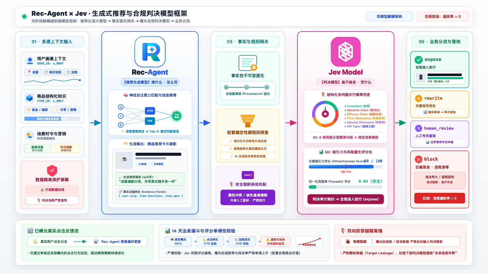

# Rec-Agent · Jev 曝光审核实验项目

> 面向电商「猜你喜欢」信息流的生成式推荐与曝光前合规审核链路。

[](rec-agent-preset/)
[](jev_adapter.py)
[](tests/)
[](data/raw/)

## 可视化工作台

**[在线体验 → qhf7.github.io/Rec-Agent](https://qhf7.github.io/Rec-Agent/)**

公开站点无需安装，输入 `u_0001`、`u_0199` 或 `u_0007` 即可查看真实历史推荐、Jev 判断、可视化图表和 JSON 导出。GitHub Pages 托管交互演示；实时模型调用使用以下本地后端。

```bash
python3 ui_server.py
```

打开 [http://127.0.0.1:8787](http://127.0.0.1:8787)，输入用户 ID，即可查看商品、曝光理由、独立 Jev 判断与评分图表。支持实时模型调用、真实历史结果演示、审核详情、运行记录和 JSON 导出，并适配手机屏幕。[启动与模型配置](docs/WEB_UI.md)。

网页使用独立 Web Harness 编排推荐，再调用 Jev；桌面 DeepSeek Harness 预设仍可单独使用。演示模式不调用模型，实时模式需要服务端模型凭据。

[界面预览](docs/assets/web-ui-desktop.png) · [手机预览](docs/assets/web-ui-mobile.png) · [工作台测试记录](docs/TEST_REPORT_WEB_UI_2026-11-20.md)

推荐生成与审核通过独立 Python 工作流衔接；DeepSeek Harness 只生成推荐 JSON，独立工作流显式运行 Jev 审核。[运行说明](docs/STANDALONE_WORKFLOW.md)。

曝光理由由大模型提炼真实卖点，创作总长度不超过 20 字符的商品卡广告，聚焦商品特性。[生成逻辑与测试方法](docs/RECOMMENDATION_COPY_GENERATION.md)，[28 条真实模型输出测试](docs/TEST_REPORT_RECOMMENDATION_COPY_2026-11-18.md)。

[桌面 Harness 严格 JSON 与 20 字符真实测试记录](docs/TEST_REPORT_STRICT_JSON_2026-11-19.md)。

[历史五题验证](docs/TEST_REPORT_JEV_FIVE_2026-11-19.md)和[九题工作流验证](docs/TEST_REPORT_JEV_MODEL_WORKFLOW_2026-11-18.md)保留各版本的真实测试记录。

[Harness → Jev 五题全链路实测](docs/TEST_REPORT_HARNESS_JEV_2026-11-20.md)：新建 Rec-Agent 会话生成 3 条推荐，独立工作流实时调用当时的 Jev 协议；记录了低置信度边界案例。

[当前 Jev 的问题、选项、输入信息与最终处置](docs/JEV_QUESTIONS_INPUT_DECISION_GUIDE.md)说明两题如何回答、历史点击的使用边界和处置规则。

[当前两题协议实测](docs/TEST_REPORT_JEV_TWO_2026-11-20.md)：26/26 个扩展请求成功解析，覆盖六类风险、披露状态和重复调用；保存评分映射与逐条结果。

[两题工作流多轮完整测试](docs/TEST_REPORT_JEV_MULTIROUND_2026-11-20.md)：三个新桌面会话生成 9 条推荐并各审核三次，另测冻结对照，共 66 次真实 Jev 调用；提供逐条表格、三组图像及边界问题分析。

Rec-Agent 根据画像、行为和场景选择商品并生成曝光理由。独立工作流调用 Jev 回答风险分型和吸引力两题，汇总为 `expose` 或 `rewrite`。

## 模型框架图



当前功能边界与运行方式见[独立工作流说明](docs/STANDALONE_WORKFLOW.md)。

## 当前实现

| 模块 | 作用 | 入口 |
| --- | --- | --- |
| **Rec-Agent preset** | 编排选品、生成用户可见曝光理由、输出严格 JSON | [`rec-agent-preset/`](rec-agent-preset/) |
| **MCP data layer** | 只读查询用户、行为、推荐反馈、商品、促销和会话场景 | [`mcp_server.py`](mcp_server.py) |
| **Canonical data contract** | 统一 `data/raw/`、`i_####` 商品 ID 和版本元数据 | [`canonical_data.py`](canonical_data.py) |
| **ModelGo Agent** | 为批量候选生成提供 dry-run / HTTP 客户端 | [`modelgo_agent.py`](modelgo_agent.py) |
| **文案事实 brief** | 提炼商品关键信息、限定事实来源、提供广告创作指令 | [`recommendation_copy.py`](recommendation_copy.py) |
| **独立工作流** | 导入推荐 JSON/候选 JSONL，构建事实并显式审核 | [`scripts/run_recommendation_workflow.py`](scripts/run_recommendation_workflow.py) |
| **Fact Bundle** | 将候选结果转换为可审核、可追溯的事实包 | [`fact_bundle.py`](fact_bundle.py) |
| **Jev Adapter** | 构建请求预览或显式调用 `jev-1.14.0` | [`jev_adapter.py`](jev_adapter.py) |
| **结果查看器** | 从 Harness 整段输出中提取 JSON，展示缩进 JSON 和推荐卡片 | [`rec-agent-viewer.html`](rec-agent-viewer.html) |
| **可视化工作台** | 输入用户 ID，串联推荐与 Jev，展示评分、处置、轨迹和导出 | [`ui_server.py`](ui_server.py) / [`web/`](web/) |
| **测试矩阵** | 覆盖 MCP、Agent、Fact Bundle、Jev 和批处理链路 | [`测试方案-Rec-Agent与Jev链路.md`](测试方案-Rec-Agent与Jev链路.md) |

## Rec-Agent 输出示例

```json
{
  "user_id": "u_0199",
  "user_profile": {
    "city": "广州",
    "city_tier": "一线",
    "climate_zone": "华南",
    "age": 38,
    "gender": "女",
    "life_stage": "学龄家长",
    "preferred_categories": [
      "3C数码",
      "母婴亲子",
      "家居日用"
    ],
    "tags": [
      "有娃",
      "家庭采购",
      "品质党"
    ],
    "active_hours": "09:00-23:00",
    "price_sensitivity": "low"
  },
  "recommendations": [
    {
      "item_id": "i_0006",
      "title": "简序 原生木浆抽纸 3层100抽×24包",
      "exposure_reason": "原生木浆抽纸，清洁随手抽",
      "generated_reason": "原生木浆抽纸，清洁随手抽",
      "evidence_fields": [
        "items.material",
        "items.functions",
        "items.category_l3"
      ],
      "context_summary": "偏好家居日用；家庭采购；日常清洁场景"
    }
  ],
  "agent_version": "rec-agent-v2"
}
```

`exposure_reason` 是商品卡直接展示给用户的一句话，总长度不超过 20 个 Unicode 字符（含标点），不含数量、尺寸、容量或技术参数；`evidence_fields` 只记录直接支撑这句话的字段；`context_summary` 用于审核和排查。促销字段可以参与内部排序，但不会写入用户可见文案。

## Jev 判决协议

独立工作流从 Jev 的两题答卷得到以下结果。

| 字段 | 说明 |
| --- | --- |
| `decision` | 合规且吸引力 > 50 时 `expose`，否则 `rewrite` |
| `compliance` | 风险选项为 `compliant` 时 `Y`，其他五类为 `N` |
| `risk_type` | `compliant`、`absolute_claim`、`efficacy_or_medical_claim`、`price_misleading`、`missing_ai_disclosure`、`off_topic` 六选一 |
| `evidence` | 输入事实引用；通过 `evidence_source` 标明来自模型选择或工作流事实快照 |
| `attractiveness_score` | 1–100 分，由 10 档有序评分及其概率换算，衡量卖点、广告语气和使用画面 |
| `decision_source` | `jev_answers_policy`，表示独立工作流按 Jev 答卷汇总 |
| `decision_reasons` | 触发当前处置的选项和门槛 |
| `escalated` | 兼容字段，当前两题协议固定为 `false` |
| `model_version` | 判决模型版本 |

[输入字段说明](docs/JEV_JUDGMENT_PROTOCOL.md)和[题目及评分标准](docs/JEV_QUESTIONS.md)记录 `jev-questions-v4-two` 使用的事实与问题。

每条候选发一次请求，Jev 独立回答一道风险选择题和一道评分题。`compliance` 和 `decision` 由工作流汇总，不增加模型题目。处置只使用模型的风险选项与吸引力分；置信度、披露配置和字段覆盖不作为额外本地门禁。

当前风险范围限于六类，不输出独立的通用事实支持结论。披露缺失由模型在风险题判断。显式选择历史五题或九题版本时仍按对应协议回放，以便复现[历史结果](docs/TEST_REPORT_JEV_FIVE_2026-11-19.md)。

## 数据

规范数据位于 [`data/raw/`](data/raw/)：

- `users.csv`：200 条用户画像、地域、兴趣、行为、购物车、活跃时段和账户状态；
- `items.csv`：200 条商品属性、类目、功能、规格、适用人群、库存和风险标签，商品 ID 固定为 `i_####`；
- `promo_rules.json`：促销规则及有效期；
- `city_climate.json`：城市气候与季节场景；
- `compliance_lexicon.txt`：审核词表；
- `history_reason_stats.csv`：历史理由统计特征。

参考分析数据位于 [`data/exposure_click_history.csv`](data/exposure_click_history.csv)，由全量候选的 14 天观察窗拆分得到，包含用户、商品、日期、曝光、点击、加购、下单和设备/位置等字段；这是可复现的模拟数据，不替代原始曝光汇总。

给 Rec-Agent 使用的事件级反馈位于 [`data/recommendation_feedback_history.csv`](data/recommendation_feedback_history.csv)，每行是一条 Jev 通过并实际展示的推荐事件，包含推荐时间、理由、点击、点击时间、位置、设备、流量来源和会话信息；它不进入 Jev 输入。

完整字段说明见 [`data/README.md`](data/README.md) 和 [`用户与商品数据说明.md`](用户与商品数据说明.md)。

## 本地运行

```bash
cd /Users/qiaohongfei/Desktop/实习/Jev曝光审核
python3 -m venv .venv
source .venv/bin/activate
pip install -r requirements-mcp.txt
pytest -q
python3 scripts/validate_data.py
python3 generate_exposure_click_history.py
python3 scripts/generate_recommendation_feedback_history.py
```

启动只读 MCP 服务：

```bash
python3 mcp_server.py
```

真实 ModelGo / Jev 调用使用环境变量，不要把密钥写入仓库：

```bash
cp .env.example .env
export MODELGO_API_KEY="<your-api-key>"
```

默认流程使用 `dry_run`，不会产生外部调用费用。接口配置说明见 [`jev_api_config.example.md`](jev_api_config.example.md)。

## 独立工作流测试

无需打开 DeepSeek Harness，可直接使用仓库样例：

```bash
python3 scripts/run_recommendation_workflow.py \
  --input examples/harness_recommendations.json \
  --output-dir /tmp/rec-agent-prepare-001
```

默认生成候选、事实包、请求预览、组合结果和报告，调用次数为 0。实际导出时替换 `--input` 文件，并使用新的输出目录。根据实际展示配置设置 `--ai-disclosure visible`、`missing` 或默认 `unknown`，披露状态独立保留。追加 `--live` 并设置 `MODELGO_API_KEY` 即调用 Jev，`workflow_results.json` 将每条推荐与对应模型判断放在同一份缩进 JSON 中。

两题协议输出曝光或需改写标签；展示、点击采集和真实反馈写入由后续业务流程实现，本脚本不生成这些事件。

## 结果查看器

Rec-Agent 预设已接入原生输出校验插件：工具步骤的前置文字不进入回答，最终结果整段通过严格 JSON、Schema、20 字符及参数词校验后，以两空格缩进输出。插件用 Markdown 硬换行保留界面排版；尾随空格属于 JSON 允许的空白，复制结果仍能直接解析。最多使用同一提供商与模型修复两次，仍不通过则本轮报错。重新加载预设并新建会话后生效。

旧消息或未使用 Rec-Agent 预设的会话可能把 JSON 空白压缩成一行。打开 [`rec-agent-viewer.html`](rec-agent-viewer.html)，粘贴整段 Harness 输出，查看器会自动提取 JSON，并显示：

1. 缩进后的完整 JSON；
2. 用户画像摘要；
3. 推荐商品卡片；
4. 曝光理由、支撑字段和上下文说明。

命令行格式化也可以使用：

```bash
pbpaste | python3 scripts/format_rec_agent_output.py
```

要从 Harness 整段消息中直接提取最后一个严格 JSON 对象：

```bash
pbpaste | python3 scripts/strict_json_output.py
```

## 目录结构

```text
.
├── data/raw/                 # 规范 mock 数据
├── rec-agent-preset/         # DeepSeek Harness Rec-Agent 预设
├── rec-agent-mcp/            # Harness MCP bundle
├── mcp_server.py             # 只读 MCP 工具服务
├── modelgo_agent.py          # 推荐候选生成客户端
├── fact_bundle.py            # Jev 事实包构造
├── jev_adapter.py            # Jev 调用、响应校验与结论解析
├── rec-agent-viewer.html     # 独立结果查看器
├── scripts/                  # 数据校验与结果格式化脚本
├── tests/                    # 自动化测试
└── docs/                     # 设计文档与实施计划
```

## 验证状态

```text
pytest -q                 520 passed
scripts/validate_data.py  PASS: all hard checks passed
```

这是一个脱离生产数据的可复现实验项目。真实生产接入时，需要替换 mock 数据源、补充权限与审计策略，并在独立环境配置 ModelGo / Jev 凭据。
