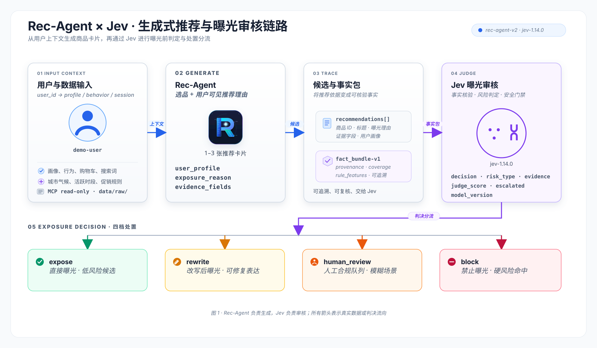

# Rec-Agent · Jev 曝光审核实验项目

> 面向电商「猜你喜欢」信息流的生成式推荐与曝光前合规审核链路。

[](rec-agent-preset/)
[](jev_adapter.py)
[](tests/)
[](data/raw/)

推荐生成与审核通过独立 Python 工作流衔接；DeepSeek Harness 只生成推荐 JSON，独立工作流显式运行 Jev 审核。[运行说明](docs/STANDALONE_WORKFLOW.md)。

这个项目把「推荐什么」和「能否曝光」拆成两个职责清晰的阶段：Rec-Agent 根据用户画像、行为和场景数据选择商品并生成一句用户可见的推荐理由；Jev 再对推荐理由进行曝光前判定，输出 `expose / rewrite / human_review / block` 四档处置结论。

## 一眼看懂项目链路



图中使用新的 Rec-Agent 图形标志与 [TypeSafe AI 官方公司 logo](https://typesafe.ai/)；官方 wordmark 资产保存在 [`docs/assets/typesafe-ai-official-logo.svg`](docs/assets/typesafe-ai-official-logo.svg)，并把链路拆成「上下文输入 → 推荐生成 → 事实追溯 → Jev 判决 → 四档处置」五个视觉区块。

## 当前实现

| 模块 | 作用 | 入口 |
| --- | --- | --- |
| **Rec-Agent preset** | 编排选品、生成用户可见曝光理由、输出严格 JSON | [`rec-agent-preset/`](rec-agent-preset/) |
| **MCP data layer** | 只读查询用户、行为、推荐反馈、商品、促销和会话场景 | [`mcp_server.py`](mcp_server.py) |
| **Canonical data contract** | 统一 `data/raw/`、`i_####` 商品 ID 和版本元数据 | [`canonical_data.py`](canonical_data.py) |
| **ModelGo Agent** | 为批量候选生成提供 dry-run / HTTP 客户端 | [`modelgo_agent.py`](modelgo_agent.py) |
| **独立工作流** | 导入推荐 JSON/候选 JSONL，构建事实并显式审核 | [`scripts/run_recommendation_workflow.py`](scripts/run_recommendation_workflow.py) |
| **Fact Bundle** | 将候选结果转换为可审核、可追溯的事实包 | [`fact_bundle.py`](fact_bundle.py) |
| **Jev Adapter** | 构建请求预览或显式调用 `jev-1.14.0` | [`jev_adapter.py`](jev_adapter.py) |
| **结果查看器** | 从 Harness 整段输出中提取 JSON，展示缩进 JSON 和推荐卡片 | [`rec-agent-viewer.html`](rec-agent-viewer.html) |
| **测试矩阵** | 覆盖 MCP、Agent、Fact Bundle、Jev 和批处理链路 | [`测试方案-Rec-Agent与Jev链路.md`](测试方案-Rec-Agent与Jev链路.md) |

## Rec-Agent 输出示例

```json
{
  "user_id": "u_0007",
  "user_profile": {
    "city": "成都",
    "life_stage": "单身职场",
    "tags": ["通勤", "租房", "熬夜"]
  },
  "recommendations": [
    {
      "item_id": "i_0057",
      "title": "素造 冷萃咖啡液 20条 美式",
      "exposure_reason": "成都通勤日常，20条冷萃美式随时来一杯",
      "generated_reason": "成都通勤日常，20条冷萃美式随时来一杯",
      "evidence_fields": [
        "users.city",
        "users.tags",
        "items.spec"
      ],
      "context_summary": "成都夏季；单身租房通勤；食品生鲜偏好"
    }
  ],
  "agent_version": "rec-agent-v2"
}
```

`exposure_reason` 是商品卡直接展示给用户的一句话；`evidence_fields` 只记录直接支撑这句话的字段；`context_summary` 用于审核和排查。促销字段可以参与内部排序，但不会写入用户可见文案。

## Jev 判决协议

Jev 接收事实包后输出以下核心字段：

| 字段 | 说明 |
| --- | --- |
| `decision` | `expose`、`rewrite`、`human_review`、`block` |
| `risk_type` | 合规、绝对化、功效/医疗、价格误导、披露缺失、主题不符 |
| `evidence` | 支撑判决的商品字段、规则计算结果或词表命中 |
| `judge_score` | 0/1/2 风险等级期望值除以 2，不是校准违规概率 |
| `escalated` | 是否升级人工审核 |
| `model_version` | 判决模型版本 |

[问题设计与输入字段说明](docs/JEV_JUDGMENT_PROTOCOL.md)。

当前 Jev 输入使用 `jev-questions-v1` 七步协议（8 个 Choice 加 1 个 Score，共 9 个 API 问题）：候选身份、事实支持、表达风险、商业准确性、场景相关性、安全门禁和最终处置。Jev 只接收当前候选的商品事实、促销快照、最小场景摘要、证据和版本信息；点击历史、CTR、订单、退款、投诉、购物车、搜索词和推荐排序信号不进入 Jev 输入。

Rec-Agent 不输出 Jev 判决字段，也不启动 Jev 请求。七个逻辑问题并行判断；工作流汇总 Q1–Q6、Q7 建议、风险类别和分数，缺证据、冲突或置信度不足转人工。旧三问响应仅用于离线兼容解析，新版真实请求要求完整标量协议。证据由工作流依据冻结事实呈现并标注来源。

本轮已验证统一契约与离线请求构造；新版九问题协议尚未进行真实 API 冒烟，历史三问实验结果不能用作本轮验证。

## 数据

规范数据位于 [`data/raw/`](data/raw/)：

- `users.csv`：200 条用户画像、地域、兴趣、行为、购物车、活跃时段和账户状态；
- `items.csv`：200 条商品属性、类目、功能、规格、适用人群、库存和风险标签，商品 ID 固定为 `i_####`；
- `promo_rules.json`：促销规则及有效期；
- `city_climate.json`：城市气候与季节场景；
- `compliance_lexicon.txt`：审核词表；
- `history_reason_stats.csv`：历史理由统计特征。

参考分析数据位于 [`data/exposure_click_history.csv`](data/exposure_click_history.csv)，由全量候选的 14 天观察窗拆分得到，包含用户、商品、日期、曝光、点击、加购、下单和设备/位置等字段；这是可复现的模拟数据，不替代原始曝光汇总。

给 Rec-Agent 使用的事件级反馈位于 [`data/recommendation_feedback_history.csv`](data/recommendation_feedback_history.csv)，每行是一条 Jev 通过并实际展示的推荐事件，包含推荐时间、理由、点击、点击时间、位置、设备、流量来源和会话信息；它不进入 Jev 输入。

完整字段说明见 [`data/README.md`](data/README.md) 和 [`用户与商品数据说明.md`](用户与商品数据说明.md)。

## 本地运行

```bash
cd /Users/qiaohongfei/Desktop/实习/Jev曝光审核
python3 -m venv .venv
source .venv/bin/activate
pip install -r requirements-mcp.txt
pytest -q
python3 scripts/validate_data.py
python3 generate_exposure_click_history.py
python3 scripts/generate_recommendation_feedback_history.py
```

启动只读 MCP 服务：

```bash
python3 mcp_server.py
```

真实 ModelGo / Jev 调用使用环境变量，不要把密钥写入仓库：

```bash
cp .env.example .env
export MODELGO_API_KEY="<your-api-key>"
```

默认流程使用 `dry_run`，不会产生外部调用费用。接口配置说明见 [`jev_api_config.example.md`](jev_api_config.example.md)。

## 独立工作流测试

无需打开 DeepSeek Harness，可直接使用仓库样例：

```bash
python3 scripts/run_recommendation_workflow.py \
  --input examples/harness_recommendations.json \
  --output-dir /tmp/rec-agent-prepare-001
```

默认仅生成候选、事实包、请求预览和报告，调用次数为 0。实际导出时替换 `--input` 文件；必须使用新的输出目录。核对实际展示的 AI 披露状态后，可设置 `--ai-disclosure visible` 或 `missing`；默认 `unknown` 保留无法核验状态。单独追加 `--live` 并设置 `MODELGO_API_KEY` 才会调用 Jev。

Jev 输出四档处置；展示、点击采集和真实反馈写入由后续业务流程实现，本脚本不生成这些事件。

## 结果查看器

Harness 的消息区域可能把 JSON 空白压缩成一行。打开 [`rec-agent-viewer.html`](rec-agent-viewer.html)，粘贴整段 Harness 输出，查看器会自动提取 JSON，并显示：

1. 缩进后的完整 JSON；
2. 用户画像摘要；
3. 推荐商品卡片；
4. 曝光理由、支撑字段和上下文说明。

命令行格式化也可以使用：

```bash
pbpaste | python3 scripts/format_rec_agent_output.py
```

要从 Harness 整段消息中直接提取最后一个严格 JSON 对象：

```bash
pbpaste | python3 scripts/strict_json_output.py
```

## 目录结构

```text
.
├── data/raw/                 # 规范 mock 数据
├── rec-agent-preset/         # DeepSeek Harness Rec-Agent 预设
├── rec-agent-mcp/            # Harness MCP bundle
├── mcp_server.py             # 只读 MCP 工具服务
├── modelgo_agent.py          # 推荐候选生成客户端
├── fact_bundle.py            # Jev 事实包构造
├── jev_adapter.py            # Jev 调用与安全门禁
├── rec-agent-viewer.html     # 独立结果查看器
├── scripts/                  # 数据校验与结果格式化脚本
├── tests/                    # 自动化测试
└── docs/                     # 设计文档与实施计划
```

## 验证状态

```text
pytest -q                 139 passed
scripts/validate_data.py  PASS: all hard checks passed
```

这是一个脱离生产数据的可复现实验项目。真实生产接入时，需要替换 mock 数据源、补充权限与审计策略，并在独立环境配置 ModelGo / Jev 凭据。
