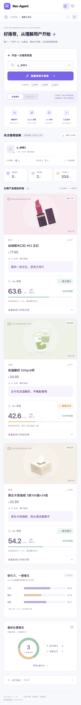

<div align="center">


# Rec-Agent

**商品推荐 · 曝光理由 · Jev 独立审核**

从用户 ID 出发，在一个工作台中查看推荐商品、曝光理由与审核结果。

<a href="https://qhf7.github.io/Rec-Agent/"></a>

[快速开始](#快速开始) · [使用文档](docs/README.md) · [Jev 协议](docs/JEV_QUESTIONS.md)

<p>


</p>

</div>

## 项目简介

Rec-Agent 是面向电商商品卡的推荐与审核工作流。推荐 Agent 根据用户画像、行为和商品资料生成推荐结果，独立 Jev 工作流完成风险分型与吸引力评分，工作台统一展示全过程结果。

| 能力 | 说明 |
| :--- | :--- |
| **个性化推荐** | 结合画像、搜索、购物车及曝光点击反馈选择商品 |
| **独立 Jev 审核** | 风险六选一、吸引力评分，输出曝光或需改写结论 |
| **可视化工作台** | 商品卡、评分图表、审核详情、运行记录与 JSON 导出 |
| **结构化接口** | 严格 JSON 输出、统一数据契约、可追溯的商品事实 |

在线演示支持 `u_0001`、`u_0199`、`u_0007`，展示已保存的真实模型运行结果。配置服务端凭据后，本地工作台可执行实时推荐与审核。

## 界面预览


<details>
<summary>查看移动端界面</summary>
<br>

</details>

## 模型框架


推荐生成与 Jev 审核相互独立，通过结构化结果连接。Web Harness 可编排完整工作流，桌面 DeepSeek Harness 预设也可单独生成推荐，再交给独立审核入口。

## 快速开始

需要 Python 3.10 或更高版本。

```bash
git clone https://github.com/Qhf7/Rec-Agent.git
cd Rec-Agent
python3 -m venv .venv
source .venv/bin/activate
pip install -r requirements-mcp.txt
python3 ui_server.py
```

打开终端提示的地址，输入用户 ID 开始体验。示例模式可直接使用；实时模式的模型凭据与启动选项见[工作台使用指南](docs/WEB_UI.md)。

如需导入已有推荐 JSON，可使用独立工作流：

```bash
python3 scripts/run_recommendation_workflow.py \
  --input examples/harness_recommendations.json \
  --output-dir runs/recommendation-preview
```

默认准备商品事实与 Jev 请求，添加 `--live` 执行模型审核。完整参数见[独立工作流指南](docs/STANDALONE_WORKFLOW.md)。

## Jev 审核

| 判断 | 输出 |
| :--- | :--- |
| 风险分型 | 合规、绝对化宣称、功效或医疗宣称、价格误导、缺少 AI 披露、偏离主题 |
| 吸引力 | 1–100 分 |
| 最终处置 | 合规且吸引力 **> 50** → `expose`；其余 → `rewrite` |

Jev 使用推荐理由及关联的商品、场景和披露信息进行判断。用户曝光点击历史用于推荐 Agent 选品，具体输入字段见[Jev 输入与输出协议](docs/JEV_JUDGMENT_PROTOCOL.md)。

## 文档导航

| 文档 | 内容 |
| :--- | :--- |
| [工作台使用指南](docs/WEB_UI.md) | 启动、模型配置与在线部署 |
| [独立工作流](docs/STANDALONE_WORKFLOW.md) | 导入推荐结果、调用 Jev 与导出 |
| [桌面 Harness 预设](rec-agent-preset/README.md) | 安装预设、输入用户 ID 与输出格式 |
| [Jev 问题与标准](docs/JEV_QUESTIONS.md) | 风险选项、吸引力评分与处置规则 |
| [数据说明](data/README.md) | 用户、商品、场景与反馈数据契约 |
| [贡献指南](CONTRIBUTING.md) | 本地开发与提交约定 |

## 项目结构

```text
Rec-Agent/
├── web/                     # 可视化工作台与在线演示
├── rec-agent-preset/        # DeepSeek Harness 预设
├── data/                    # 统一用户、商品与反馈数据
├── docs/                    # 使用指南与协议参考
├── examples/                # 工作流输入样例
├── scripts/                 # 工作流与数据工具
├── tests/                   # 自动化验证
├── ui_server.py             # Web 工作流后端
├── mcp_server.py            # 只读 MCP 数据服务
├── fact_bundle.py           # 可追溯事实包
└── jev_adapter.py           # 独立 Jev 调用适配器
```

技术栈：Python · MCP · DeepSeek / ModelGo API · Jev · JavaScript · HTML / CSS · GitHub Pages。

仓库中的用户、商品与点击反馈均为合成数据，适合演示、开发和研究。实际商品曝光、文案改写与点击回传可由业务系统接入。
