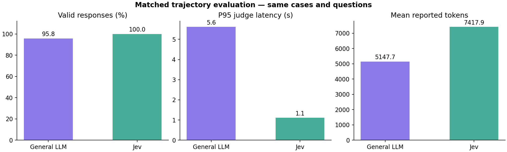
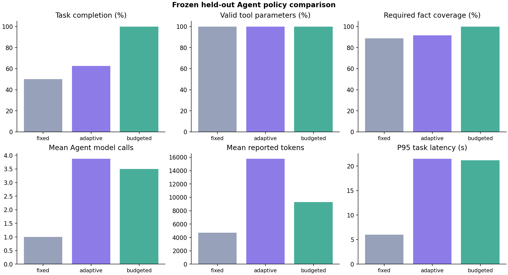

# Agent 评测、工具决策与训练结果

## 实验范围

本轮完成版本核对、评审器同口径对照、用户隔离任务集、预算工具执行器、真实轨迹采集、小模型 LoRA 训练、留出与组件消融、检索基线，以及偏好标注准备。进度见[任务清单](AGENT_ROADMAP.md)。

开始时本地与 GitHub `main` 均为 `03876a9`。任务固定为开发12条、留出8条，用户标识完全隔离（留出含7个已知用户、1个未知用户控制）；数据均为项目合成数据。场景覆盖暖启动、冷启动、未知用户、空检索、工具超时与商品缺字段。

评审模型为 Jev 1.14.0，通用模型为桌面 Harness 当前的 `deepseek-v4.1-flash-1017` 服务。本实验新增执行轨迹评测协议，线上商品文案的风险/吸引力两题保持独立。

## 1. 大模型与 Jev 同口径对照

主结果使用统一12次工具预算实验的24条真实留出轨迹（8任务×3策略），两个评审器判断任务完成、参数是否全部有效、事实覆盖是否完整。双方接收相同题目及事实，并发2、各评1次、无自动重试，共48次真实请求。只传模型实际可见的工具观察，程序核验标签不传给评审器。

| 指标 | 通用大模型 | Jev |
| --- | ---: | ---: |
| 有效回答 | 23/24（95.8%） | 24/24（100%） |
| 任务完成判断与程序核验一致 | 15/24（62.5%） | 20/24（83.3%） |
| 参数判断与程序核验一致 | 23/24（95.8%） | 22/24（91.7%） |
| 事实覆盖判断与程序核验一致 | 21/24（87.5%） | 24/24（100%） |
| 每轨迹平均评审调用 | 1 | 1 |
| 平均报告输入 token | 5,099.7 | 7,315.9 |
| 平均报告输出 token | 48.0 | 102.0 |
| 平均报告总 token | 5,147.7 | 7,417.9 |
| P95评审延迟 | 5.62s | 1.11s |

Jev 本批次的 P95 约快5.05倍，任务完成与事实覆盖的契约判断一致率更高；**参数判断未超过通用模型，报告 token 也更高**。两家服务的tokenizer和计数不同，token不等同金额；没有可核验单价，不报告费用节省。

通用模型1次连接失败保留在全请求分母；仅有效答复中，三题一致率分别为15/23（65.2%）、23/23（100%）、21/23（91.3%）。Jev分别为20/24、22/24、24/24。双方均有错误，精确参数和预算应由程序核验。

程序参考确认17/24条轨迹完成任务（70.8%）；通用模型在有效答复中判断完成9/23（39.1%），Jev判断完成13/24（54.2%）。这些是对同一批轨迹的**完成判断**，不是更换评审器导致Agent完成率改变。

前置构造对照另含12条轨迹、6个独立开发任务，双方各24次请求。Jev24/24有效，通用23/24；完整重复配对分别12/12、11/11一致，缺答不算语义不一致。这组验证受控错误，不与真实留出成绩混合。

## 2. Agent 六项指标

三策略使用同一模型、用户任务、工具和12次工具上限，最多8轮模型调用，单次输出上限4096。预算策略另有120秒墙钟限制、观察压缩和信息齐备结束控制。按用户要求，**无token预留、无累计token门槛**，token仅测量。策略按任务交错运行。

| 策略 | 任务完成率 | 参数正确率 | 事实覆盖率 | 平均模型调用 | 平均工具调用 | 平均报告总token | P95任务延迟 |
| --- | ---: | ---: | ---: | ---: | ---: | ---: | ---: |
| 固定流程 | 4/8（50.0%） | 100% | 88.9% | 1.000 | 6.375 | 4,698.8 | 6.00s |
| 自主工具 | 5/8（62.5%） | 100% | 91.7% | 3.875 | 10.500 | 15,772.9 | 21.48s |
| 预算约束 | 8/8（100%） | 100% | 100% | 3.500 | 7.625 | 9,285.1 | 21.18s |

相对自主策略，预算策略本批次完成率高37.5个百分点，工具调用少27.4%，报告token少41.1%。P95仅小幅变化，固定流程仍更快、更省token；不能声称所有指标占优。

完成要求：目标用户正确；已知用户输出1–3件真实、有库存且已获取详情的商品；理由满足展示约束；证据路径真实非空；所需画像、行为、历史、场景及商品已观察；未超任务预算。未知用户需查得不存在并正确返回空结果。事实覆盖按所需事实组微平均；参数率包含失败前尝试，合法超时不算参数错误。字段匹配不证明文案语义真实性或用户真实偏好。

首次顺序运行的自主策略8条均连接失败；后续交错确认得到固定5/8、自主5/8、预算7/8。早期策略工具上限也不同，因此主表使用再次冻结的统一12次预算结果。原始失败保留，未依据留出结果更改提示词、训练标签或商品事实。

## 3. 组件消融

在预先列明的前4个留出任务运行，其他条件相同；各组均完成4/4。

| 配置 | 平均模型调用 | 平均工具调用 | 平均总token |
| --- | ---: | ---: | ---: |
| 完整预算策略 | 3.25 | 6.75 | 8,081.5 |
| 关闭观察压缩 | 3.25 | 7.25 | 9,056.3 |
| 关闭信息齐备结束 | 3.50 | 7.75 | 10,074.0 |

两机制有降低上下文和调用消耗的迹象，但仅4个任务，不能证明普遍提升。三策略主比较同时包含多项机制，不是单因素实验。

## 4. 真实轨迹与 LoRA

24条真实开发轨迹筛出20条程序核验成功轨迹，12独立用户、72动作。训练与内部验证按用户隔离（10/2），仅采可观察动作与结果。动作须回指原始模型响应，观察须匹配真实工具返回或其明确投影；构造轨迹、留出用户和失败任务不能进入训练。

| 项目 | 实际配置 |
| --- | --- |
| 基座 | 缓存 Qwen2.5-0.5B-Instruct，基座权重冻结 |
| LoRA | rank4、alpha16、q_proj/v_proj |
| 可训练参数 | 270,336 |
| 设备/优化步/耗时 | Apple MPS / 8步 / 91.1秒 |
| 有效训练/验证 | 24动作/10用户；6动作/2用户 |
| 上下文 | 2048；42/72超长动作排除，不截断事实后监督 |
| Loss | 仅assistant动作与EOS计算，prompt位置mask |

训练CE从0.6582降至0.2773，内部验证从0.7167降至0.2845。可用训练24动作含22工具动作、2最终回答；8优化步×2梯度累积实际呈现16个训练样本，不代表24条全部训练一遍。主要学习早期决策，仅验证小样本训练可行性。

| 独立留出单步诊断（8个隔离标识任务） | 基座 | LoRA后 |
| --- | ---: | ---: |
| 严格有效动作JSON | 0/8 | 2/8 |
| 工具与参数精确正确 | 0/8 | 2/8 |
| 工具名正确 | 3/8 | 3/8 |
| 普通完整JSON对象 | 8/8 | 3/8 |
| Teacher-forced CE | 1.1790 | 0.4792 |

8个单步诊断明确给出下一步信息需求，属于工具选择测试而非自主规划。固定生成128tokens时部分LoRA输出截断，完整JSON率下降，不能概括为整体质量改善。另对相同暖启动、未知用户进行base/LoRA完整工具执行，各2任务均0/2完成；格式、参数和停止行为仍不足，尚不能替代推荐模型。后续扩充恢复轨迹与数据时，需重新设立未用评测集。

## 5. 检索与偏好优化

实现规则、中文bigram BM25、RRF混合加规则重排。购物车仅作弱标签，不进排序或查询；搜索词恢复单独报告。

| 留出购物车弱标签（7用户） | Recall@10 | MRR@10 | NDCG@10 |
| --- | ---: | ---: | ---: |
| 规则 | 0.0643 | 0.0444 | 0.0362 |
| BM25 | 0.0643 | 0.0714 | 0.0451 |
| 混合＋规则重排 | 0.0643 | 0.0561 | 0.0402 |
| 开发集训练的线性Pairwise重排 | 0.1119 | 0.0952 | 0.0690 |

混合规则方案未显示普遍优势。随后以9个开发用户的19个购物车正例和152对负采样，训练7维线性Pairwise Logistic重排器（L2正则、2000步）。排序输入只含偏好、搜索及商品事实，购物车仅作为训练标签；冻结参数后，7用户弱标签结果如表。该留出集的基线结果此前已查看，因此新增重排属于探索性验证，不称新的盲测。尚无向量召回，弱标签恢复不是线上推荐效果，也不是大模型偏好训练。

已准备6对同任务开发输出、匿名A/B标注表与来源哈希。人工偏好标签为0，DPO尚未执行；只有可靠标注后才生成chosen/rejected，不将Jev自评分作为人工标签。

## 6. 产物与限制

[复现指南](AGENT_BENCHMARK.md) · [任务进度](AGENT_ROADMAP.md) · [聚合指标JSON](assets/agent-benchmark/summary.json)

原始请求、响应、轨迹、训练适配器与标注表保存在本机忽略目录 `runs/agent-benchmark-v1/`；公开图表与聚合指标不含凭据。

仅20任务、8个隔离留出标识任务、200合成商品；程序契约参考不是独立人工语义金标。网络、缓存和采样影响重复结果，P95是小样本经验分位数。当前证据支持Jev在本配置下响应更快、部分契约一致性更好，不支持全面优于通用模型。
