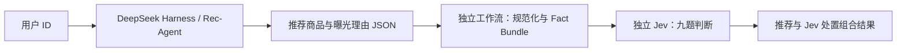

# Jev 判断问题与输入契约

DeepSeek Harness/Rec-Agent 接收用户 ID，查询数据并生成推荐商品和曝光理由，输出严格 JSON 后结束。独立的 `scripts/run_recommendation_workflow.py` 导入这份结果，构建 Fact Bundle，再显式调用 Jev；Jev 输出各题判断和处置结论。工作流将两阶段结果按推荐条目关联保存。

## 一、供 Jev 判断的问题

| 逻辑问题 | 核验重点 | 允许回答 |
| --- | --- | --- |
| Q1 身份一致性 | 理由 ID、商品 ID、数据版本、事实来源是否一致 | valid / invalid / unverifiable |
| Q2 事实支持 | 核验客观及明确暗示的主张，区分一般场景、行动建议和纯主观表达 | supported / partial / unsupported / unverifiable |
| Q3 表达风险 | 绝对化、功效医疗、商业误导及其它表达风险 | clean / rewriteable / blocking |
| Q4 商业准确性 | 价格、折扣、门槛、赠品、适用范围和起止时间 | verified / mismatch / not_mentioned / unverifiable |
| Q5 场景相关性 | 理由采用的场景、身份与商品是否匹配 | relevant / off_topic / unverifiable |
| Q6 安全判断 | 资料缺失、冲突、敏感功效或资质疑点所对应的判断 | pass / human_review / fail |
| Q7 处置结论 | Jev 根据同一份输入事实决定当前文案的处置 | expose / rewrite / human_review / block |

另有两个 API 问题：`risk_type` 选择六类主要风险，`judge_score` 评估三级风险严重度。总计八道单选、一道评分，一条推荐对应一次请求。

当前默认版本为 `jev-questions-v2`。`jev-questions-v2-q2-legacy` 只将 Q2 换回冻结旧题，用于固定其他变量的对照。Q4 保留原文。判断边界见 [审核口径](JEV_REVIEW_RUBRIC.md)，实际发送的原文、选项和评分标准见 [问题清单](JEV_QUESTIONS.md)。

九题在同一请求中并行判断，Q7 根据同一份事实独立作出处置，不能假定它先读取了 Q1–Q6 的答案。Q1–Q6、风险分类、严重度与置信度用于呈现模型各维度判断；工作流最终 `decision` 直接采用 Q7。

## 二、交给 Jev 的信息

| 输入层 | 实际字段/内容 | 来源与用途 |
| --- | --- | --- |
| 候选 | reason_id、item_id、exposure_reason、generated_reason、evidence_fields、schema/data version | 固定本次审核文本；两份理由必须完全相同 |
| 商品 | 标题、品牌、三级类目、功能、材质、规格、人群、季节、允许功效、资质、价格、库存、监管与风险说明 | 来自同版本 data/raw/items.csv；销售量、评分、退货或投诉率不进入 Jev 输入 |
| 商业快照 | promo_id、规则类型、适用范围、有效期、门槛、减额、折扣和赠品 | data/raw/promo_rules.json；按快照日期计算，单品适用性不代表购物篮满足门槛 |
| 最小场景 | 城市、城市层级、气候区、生命周期、场景标签、活跃时段 | data/raw/users.csv 的受限字段 |
| 气候与时间 | 规范城市气候区、梅雨月份、场景日期、快照时间与时区 | data/raw/city_climate.json + 冻结 snapshot_at；标明模拟场景时间 |
| 校验与来源 | 词表命中、规则特征、字段覆盖、verification_state、provenance、AI 披露状态 | 工作流计算并冻结，作为模型核验线索及追溯信息 |
| 追踪 | reason_id、item_id、候选/事实/问题/数据版本、agent/model version | 用于关联与回放；Jev 不接收 user_id |

推荐点击历史、CTR、曝光统计、原始搜索词、购物车明细、订单、退款、投诉、账户标识、设备、排序分、相似用户统计、人工 gold 标签和模拟潜在结果不传给 Jev。`context_summary` 可留在本地候选供排查，含行为细节的自由文本不直接作为 Jev 事实。

输入校验同时检查键和值的类型，数组逐项检查。证据路径必须指向实际发送且有值的字段；快照和版本存在漂移时作为数据错误处理。

## 三、处置结论与结果字段

| 字段 | 含义 |
| --- | --- |
| `decision` | Jev Q7 的原始选择，四档处置之一 |
| `decision_source` | `jev_model` |
| `decision_question` | 当前协议为 `q7_final_decision`；历史三问回放为 `decision` |
| `decision_confidence` | 处置题的置信度 |
| `question_choices` | 各单选题的选择，保留题间差异 |
| `question_confidences` | 每题置信度 |
| `confidence` | 全部问题最低置信度，用于分析 |
| `risk_type` | Jev 选择的主要风险分类 |
| `judge_score` | 严重度期望值归一化至 0–1 |
| `disclosure_status` / `configuration_notes` | 展示配置状态及独立注记 |
| `escalated` | 兼容标记，表示处置是否为 `human_review` |

`human_review` 表示模型给出的“人工复核”处置标签。当前工作流到结果输出为止，不包含实际人工复核、派单或复核回填。`rewrite` 同样表示模型判定需要改写，不自动启动生成器改写。

工作流解析并原样保存 Jev 的处置；Q1–Q6、置信度、分数、事实完整性和披露配置不会通过本地规则改写这个结论。它们可以与 Q7 存在不一致，结果会完整保留以供分析。接口失败、响应格式错误、身份或模型版本不匹配进入错误产物，不伪造一条审核结论。

Score 的等级为 0/1/2，从返回概率分布计算期望等级后除以 2。该值表示风险严重度，不是经过真实业务结果校准的违规概率。各题置信度与严重度分开保存。

`evidence` 默认呈现输入事实引用，`evidence_source=workflow_fact_snapshot`。它不声称是 Jev 自由生成的逐句解释；模型提供有效证据路径时单独标明来源。模型响应与解析结果分别落盘。

## 四、工作流产物

`workflow_results.json` 把推荐商品、曝光理由和对应 `jev_audit` 放在一份缩进 JSON 中，同时保留独立候选、事实包、请求、原始响应和模型结论文件。输入文件中的 Harness 推荐保持原始职责，审核字段由独立工作流关联。



## 五、数据统一与回放

唯一规范源为 `data/raw/`。商品 ID 为 `i_####`，金额为整数分，候选契约 `rec-candidate-v2`，事实包 `fact-bundle-v2`，数据版本 `canonical-2026-06-15-v1`。MCP、离线生成器和工作流共享加载器。

旧 `item_####` 通过 `scripts/migrate_legacy_candidates.py` 显式迁移，同时核对数字后缀、标题和品牌。canonical 候选禁止快照字段漂移或伪造功效、促销。

Harness 导出会创建本次 canonical 快照；已有 JSONL 回放保留原快照子集、原时间和原查询记录，缺字段保留缺失状态。模拟场景基准为 2026-06-15，与执行当天不同。

## 六、运行与验证

```bash
python3 scripts/run_recommendation_workflow.py \
  --input examples/harness_recommendations.json \
  --output-dir runs/recommendation-prepare-001
```

默认准备输入和请求，`network_calls=0`。设置 `MODELGO_API_KEY` 并显式增加 `--live` 即调用 Jev，披露参数依据实际展示配置填写。完整命令与产物说明见 [独立工作流](STANDALONE_WORKFLOW.md)，当前验证见 [工作流验证报告](TEST_REPORT_JEV_MODEL_WORKFLOW_2026-11-18.md)。
