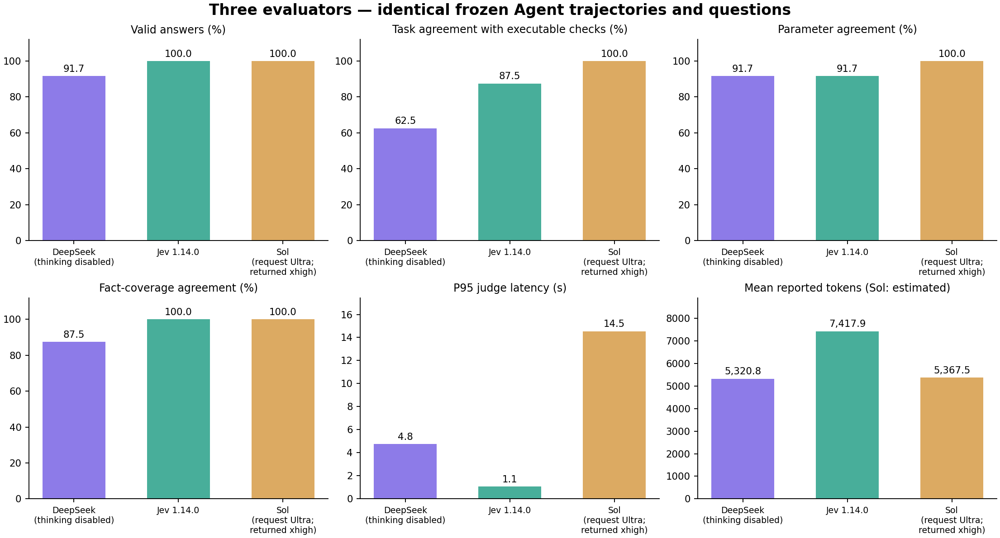

# DeepSeek、Jev 与 Sol 推理模型对照

## 上一轮通用模型与思考强度

上一轮通用大模型来自桌面 Harness 当前使用的 OpenAI Chat Completions 兼容服务。评测代码单独构建请求，不继承桌面会话的思考强度。

| 项目 | 实际配置 |
| --- | --- |
| API基础地址 | `https://www.suanyouyou.com/v1` |
| 请求模型标识 | `deepseek-v4.1-flash-1017` |
| 响应模型标识 | `deepseek-v4-1-flash-261017` |
| 思考 | `thinking: {type: disabled}` |
| 返回推理token | 已保存的23份有效响应均为0 |
| 其他参数 | temperature=0，单次输出上限500，严格JSON |

因此，上轮结果应表述为 **DeepSeek关闭思考的评审基线**，不能表述为桌面 Harness 的 Max 强度。原始评测与新结果分别保留。

## 新增模型的服务配置

通过用户指定的第三方服务目录查得模型 `gpt-6.1-sol`，支持 Chat Completions 与 Responses。兼容性探测后使用 Responses，配置如下：

| 项目 | 请求与观测 |
| --- | --- |
| API基础地址 | `https://www.highland-api.com/v1` |
| 路由 | `/responses` |
| 模型 | `gpt-6.1-sol` |
| 请求思考强度 | `reasoning.effort=ultra` |
| 24次正式响应的强度回显 | 全部为 `reasoning.effort=xhigh` |
| 单次输出上限 | 8192，包含模型推理与最终回答额度 |
| 输出 | 严格JSON；未发送关闭思考参数 |

`gpt-6.1-sol-ultra` 后缀探测返回404；Chat Completions接受ultra参数但未回显档位。正式测试采用能观察到档位的Responses路线，保留原始Ultra请求；**不能确认本服务执行了Ultra档，准确名称是“Sol，请求Ultra、回显xhigh”**。模型目录和响应标识描述供应商行为，不构成底层模型身份的独立验证。

## 实验口径

- 直接复用上一轮冻结的24条真实Agent轨迹（8任务×3策略），不重生成推荐或调整程序参考。
- 各服务收到相同state、问题、商品事实和模型可见工具观察；每个case的SHA-256与原清单一致。
- 评测三题：任务是否完成、工具参数是否全部有效、所需事实覆盖是否完整。程序契约参考不发送给评审器。
- 三服务在同一个固定种子交错队列中执行，并发2、各24次，共72请求；无自动重试，失败不从全请求分母移除。
- 这是模型、推理配置及服务协议的联合对照：DeepSeek关闭思考；Sol请求Ultra但回显xhigh；Jev不配置通用模型思考等级。不是仅改变模型权重的实验。
- 没有累计token门槛或token预留。服务所需的单次最大输出参数与真实消耗分别记录；没有因输出上限截断的有效回答。

## 结果

下表使用全部24次尝试作为比例分母，P95包含传输失败的墙钟时间。

| 指标 | DeepSeek关闭思考 | Jev 1.14.0 | Sol：请求Ultra／回显xhigh |
| --- | ---: | ---: | ---: |
| 有效回答 | 22/24（91.7%） | 24/24（100%） | 24/24（100%） |
| 任务完成判断与程序参考一致 | 15/24（62.5%） | 21/24（87.5%） | 24/24（100%） |
| 参数判断与程序参考一致 | 22/24（91.7%） | 22/24（91.7%） | 24/24（100%） |
| 事实覆盖判断与程序参考一致 | 21/24（87.5%） | 24/24（100%） | 24/24（100%） |
| 每轨迹评审调用 | 1 | 1 | 1 |
| 平均评审延迟 | 3.39秒 | 0.70秒 | 10.64秒 |
| P95评审延迟 | 4.75秒 | 1.06秒 | 14.53秒 |
| 平均输入token | 5,272.8 | 7,315.9 | 5,142.1（估算） |
| 平均输出token | 48.0 | 102.0 | 225.4（估算） |
| 平均总token | 5,320.8 | 7,417.9 | 5,367.5（估算） |
| 平均推理token | 0 | 未提供 | 179.3（服务报告／估算） |
| 传输失败／解析失败 | 2／0 | 0／0 | 0／0 |



Token均值以有计量的响应计算，DeepSeek为22次，其他为24次；DeepSeek2次连接失败的usage记未知，不补零。Jev的总token由其返回的input_tokens与output_tokens相加，非假设其存在原生total字段。Sol全部24次usage明确带 `customer_usage.estimated=true`，来源含client_request/fixed_deduction；不能当作可核验原生账单用量。不同服务tokenizer、计数和缓存方式不同，不按这些数字推导金额或token效率排名。

DeepSeek仅有效答复的一致率分别为15/22（68.2%）、22/22（100%）、21/22（95.5%）；另两模型没有缺答，全请求与有效答复口径相同。完整逐条结果见[case-results.json](assets/provider-comparison/case-results.json)，聚合指标见[summary.json](assets/provider-comparison/summary.json)。

## 如何解释

1. **本批次Sol的程序契约判断最一致。** 三题均24/24；Jev的任务判断有3处、参数判断有2处不一致。不能说Jev在所有质量指标上更优。
2. **Jev的本批次速度优势明显。** Sol/Jev的P95延迟比约13.74:1，DeepSeek/Jev约4.50:1；这是当前服务配置和并发条件下的结果，不代表所有部署。
3. **没有验证实际Ultra。** 请求未降级，但服务端回显xhigh；需要供应商明确Ultra路由或提供可验证的Ultra端点后，才能补充真正同名档位实验。
4. **没有独立人工语义金标。** 参考仅检查结构、观察事实和预算约束，不代表推荐相关性、营销质量或真实点击率。
5. **样本存在类别覆盖限制。** 24条轨迹仅对应8个隔离任务标识（7个已知用户、1个未知用户控制）；参数参考全部为all_valid，事实覆盖仅full/partial，没有none。因此本批次不能衡量无效参数或零覆盖的检出能力；先前受控错误集另行保存，不能混成更大独立样本。
6. **Agent自身六项指标不因更换评审器而改变。** 本轮评审的是相同冻结执行结果，不重新运行Agent或宣称其任务完成率被提高。执行策略对照仍见[Agent评测结果](AGENT_EVALUATION.md)。

## 复现

使用 [`agent_benchmark/providers.py`](../agent_benchmark/providers.py)。配置只保存环境变量名，凭据由进程环境提供。参考配置见[三服务配置样例](../examples/evaluator_providers.json)。

```bash
python3 -m agent_benchmark.providers --manifest runs/agent-benchmark-v1/judge-matched-final/manifest.json --config-file examples/evaluator_providers.json --output runs/provider-comparison --workers 2 --repeats 1 --timeout 180
python3 -m agent_benchmark.provider_report --run runs/provider-comparison --output runs/provider-comparison/figures
```

该命令会真实调用三项服务；需先按[Agent评测指南](AGENT_BENCHMARK.md)生成冻结轨迹与manifest。请求、响应、HTTP状态、服务端请求标识、原始usage及档位回显分别保存；隐藏推理正文不用于评测或公开展示。
