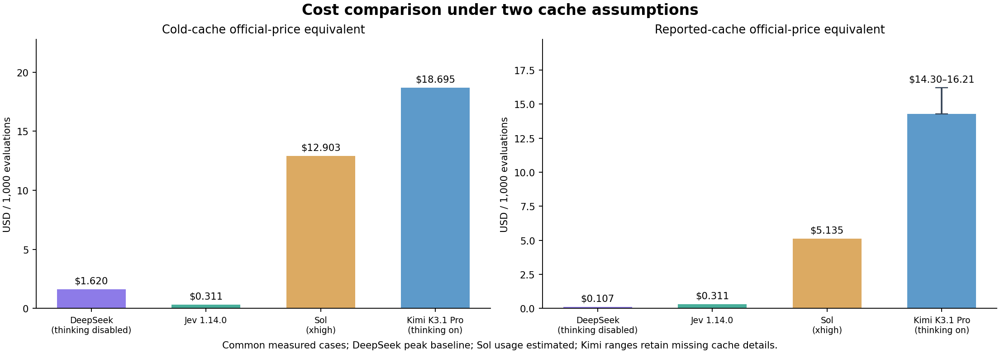

# 四模型评测与官方价格折算

## 模型与思考配置

| 模型 | API模型标识 | 图表中的思考设置 |
| --- | --- | --- |
| DeepSeek V4.1 Flash | `deepseek-v4.1-flash-1017` | 关闭思考，推理token为0 |
| Jev 1.14.0 | `jev-1.14.0` | 专用判决模型，不设通用推理档位 |
| Sol | `gpt-6.1-sol` | `xhigh`，依据响应元数据 |
| Kimi K3.1 Pro | 接入别名 `kimi-k3.1-pro-zbs`，响应 `kimi-k3.1-pro` | 思考开启，依据实际推理token；未回显具体档位 |

DeepSeek与Kimi使用同一基础地址、独立凭据。Kimi官方支持low/high/max且默认max，本轮显式设置max；展示层只呈现已观测的“思考开启”。请求与响应配置保留在原始审计记录中，图表只显示实际观测设置。

## 同口径结果

四家重跑同一冻结24条Agent轨迹（8个隔离任务标识×3策略），共96次请求。问题、程序参考及可见事实逐case哈希一致；固定种子交错运行，并发2，每case每模型1次，无自动重试。比例以全部24次尝试为分母。

| 指标 | DeepSeek｜关闭思考 | Jev | Sol｜xhigh | Kimi｜思考开启 |
| --- | ---: | ---: | ---: | ---: |
| 有效回答 | 23/24 | 24/24 | 24/24 | 24/24 |
| 任务完成判断一致 | 16/24（66.7%） | 22/24（91.7%） | 24/24（100%） | 23/24（95.8%） |
| 工具参数判断一致 | 23/24（95.8%） | 23/24（95.8%） | 24/24（100%） | 24/24（100%） |
| 事实覆盖判断一致 | 22/24（91.7%） | 24/24（100%） | 24/24（100%） | 23/24（95.8%） |
| P95评审延迟 | 3.75秒 | 1.12秒 | 14.23秒 | 56.05秒 |
| 平均评审延迟 | 3.10秒 | 0.68秒 | 10.55秒 | 22.56秒 |
| 每轨迹评审调用 | 1 | 1 | 1 | 1 |
| 用量可计量请求 | 23/24 | 24/24 | 24/24 | 24/24 |

DeepSeek的1次连接失败保留在分母；有效答复条件下三题一致率分别为16/23（69.6%）、23/23（100%）、22/23（95.7%）。其余三家无传输或解析失败。


Sol本批程序契约判断全部一致；Kimi任务及覆盖各有1处不一致；Jev任务有2处、参数有1处不一致，但响应更快。一致率不是人工审核准确率。参数参考全部为all_valid，覆盖只有full/partial，不能单凭本批验证invalid参数或零覆盖的检出能力。

## 官方单价

核验日期：2026-11-20。单位均为**美元／百万token**，采用标准实时短上下文费率，不含税、批量折扣或加速服务费。

| 模型 | 未缓存输入 | 缓存命中输入 | 输出 | 缓存写入 | 官方来源 |
| --- | ---: | ---: | ---: | --- | --- |
| DeepSeek Flash：峰时基准 | $0.30 | $0.006 | $1.20 | 无单独写入费 | [DeepSeek定价](https://api-docs.deepseek.com/quick_start/pricing) |
| DeepSeek Flash：谷时情景 | $0.15 | $0.003 | $0.60 | 无单独写入费 | 同上 |
| Jev 1.14 | $0.042 | $0.042（统一输入费率） | $0 | 无单独缓存档 | [TypeSafe模型与价格](https://docs.typesafe.ai/models) |
| Sol 标准档 | $2.00 | $0.10 | $10.00 | 30分钟$2.50；12小时$5.00 | [OpenAI定价](https://developers.openai.com/api/docs/pricing) |
| Kimi K3.1 Pro | $2.00 | $0.20 | $10.00 | 5分钟$2.00；1小时$4.00 | [Kimi定价](https://platform.kimi.ai/docs/pricing/chat) |

推理token已包含在输出计量中，不重复收费。缓存命中、写入、未缓存输入分开计价；缺失计量保留区间。配置见[官方费率快照](../examples/official_model_prices.json)。

## 美元成本比较

**以下是按官方价格折算的等效成本，不是中转平台实付账单。** 四家均通过第三方接入，没有账单不能确认实际扣费。Sol全部usage明确为估算，其成本同样为估算。

主表只比较四家都有输入/输出计量的共同23个case。每千次为“共同case平均单次成本×1000”，不以失败次数稀释费用。

| 模型 | 统一冷缓存：USD／千次评审 | 按本次缓存计量：USD／千次评审 | 共同计量case |
| --- | ---: | ---: | ---: |
| DeepSeek峰时基准 | $1.6203 | $0.1069 | 23/24 |
| Jev | $0.3111 | $0.3111 | 23/24 |
| Sol xhigh | $12.9025＊ | $5.1355＊ | 23/24 |
| Kimi思考开启 | $18.6947 | $14.2998–$16.2148 | 23/24 |

＊Sol为接口估算usage乘官方单价，不是已核验支出。



- **冷缓存列**：相同case输入统一按cache miss计价，不计新建缓存，隔离缓存热度。DeepSeek采用峰时标准作比较基准。
- **本次缓存列**：逐次使用实际报告的命中与写入计量。Kimi4条响应缺少缓存读取量，另4条非零写入未提供TTL，均保留区间，不补成0。
- **谷时情景**：DeepSeek冷缓存为$0.8102／千次，按已报缓存为$0.0534／千次。本次运行在官方谷时范围，峰时列不是本次实际收费。
- **缺失费用**：DeepSeek1次失败未提供usage，完整24次总费用未知；有计量小计不把该失败视为免费。

| 模型 | 有计量响应 | 冷缓存官方价等效小计 | 小计口径 |
| --- | ---: | ---: | --- |
| DeepSeek峰时基准 | 23/24 | $0.037268 | 各自有计量case；非配对主表 |
| Jev | 24/24 | $0.007374 | 各自有计量case；非配对主表 |
| Sol xhigh | 24/24 | $0.305538＊ | 各自有计量case；非配对主表 |
| Kimi思考开启 | 24/24 | $0.486634 | 各自有计量case；非配对主表 |

冷缓存共同case中Jev的官方价折算最低；按本次高缓存命中量，DeepSeek更低。优势取决于缓存和峰谷档，不能说Jev始终最便宜。Kimi包含较多推理输出，本批质量较高，但延迟与折算成本也更高。

## 复现与产物

```bash
python3 -m agent_benchmark.providers --manifest runs/agent-benchmark-v1/judge-matched-final/manifest.json --config-file examples/evaluator_providers.json --output runs/provider-comparison --workers 2 --repeats 1 --timeout 180
python3 -m agent_benchmark.provider_report --run runs/provider-comparison --output runs/provider-comparison/figures --prices examples/official_model_prices.json
```

使用独立 `DEEPSEEK_API_KEY`、`MODELGO_API_KEY`、`HIGHLAND_API_KEY`、`KIMI_API_KEY`。凭据仅在本机进程加载，Kimi凭据不覆盖推荐端配置。

- [逐例答案、用量与延迟](assets/provider-comparison/case-results.json)
- [汇总与费率](assets/provider-comparison/summary.json)
- [共同case成本](assets/provider-comparison/paired-costs.json)
- [各自有计量case成本](assets/provider-comparison/costs.json)
- [CSV对照](assets/provider-comparison/comparison.csv)

原始响应与官方价页面快照保留在本机忽略目录，公开产物不含凭据。模型与思考元数据只是接口观测，不是底层权重身份的独立证明。程序参考不是人工语义金标；24条轨迹来自8个任务且有关联，每case只评1次，不证明重复稳定性。
