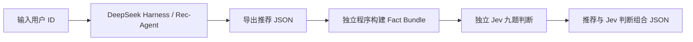

# 推荐生成与独立 Jev 判断工作流

工作流通过严格JSON连接两个阶段：DeepSeek Harness/Rec-Agent根据用户输入生成推荐商品和曝光理由；独立Python程序接收该结果、构建事实包并调用Jev。Jev输出各题判断及四档处置，程序按商品关联保存，最终 `decision` 原样来自模型Q7。



`human_review`是Jev可选择的处置标签；当前流程到结果输出为止，不执行实际人工复核、派单或复核回填。`rewrite`同样是处置结论，不会自动重新生成文案。真实页面展示和点击事件采集属于后续业务接入。

## 1. 导出 Harness 推荐

将Harness最终答案保存为UTF-8严格JSON，例如 `harness-result.json`：

```json
{
  "user_id": "u_0001",
  "recommendations": [
    {
      "item_id": "i_0001",
      "exposure_reason": "折叠收纳，35L大容量更省心",
      "generated_reason": "折叠收纳，35L大容量更省心",
      "evidence_fields": [
        "items.spec",
        "items.functions"
      ],
      "context_summary": "使用商品规格与折叠收纳功能"
    }
  ],
  "agent_version": "rec-agent-v2"
}
```

- 有候选时，`user_id`须为 `data/raw/users.csv` 中存在的 `u_####`，`item_id`须为 `data/raw/items.csv` 中存在的 `i_####`。未知用户返回空推荐列表时，工作流正常结束，Jev调用为0，即使指定 `--live` 也无需密钥。
- `exposure_reason`与兼容字段 `generated_reason`至少提供一个；同时存在时须完全相同。
- `reason_id`可省略，程序据用户、商品与理由生成稳定ID；提供时格式为 `r_` 加字母、数字、下划线或连字符，同批不得重复。
- `evidence_fields`指向实际发送给Jev的事实；`context_summary`在本地候选中保留。
- 输入须是完整严格JSON，不接受过程文字、代码围栏、重复键、`NaN`或`Infinity`。整段对话可先用 `scripts/strict_json_output.py` 提取最终JSON。
- Harness推荐只包含生成结果，审核结论由独立Jev阶段生成。

`--input-format auto`自动识别Harness导出对象或逐行候选；也可明确指定 `harness` / `jsonl`。候选JSONL使用 `rec-candidate-v2` 和 `canonical-2026-06-15-v1`，旧 `item_####` 数据先经独立迁移脚本核对身份。

## 2. 准备事实与请求

```bash
python3 scripts/run_recommendation_workflow.py \
  --input harness-result.json \
  --output-dir runs/recommendation-prepare-001
```

默认读取本地规范数据，生成候选、事实包、请求预览和组合结果；网络调用为0，组合结果的 `audit_status` 为 `prepared`、`jev_audit` 为null。

披露参数按实际展示配置填写：

| 参数 | 意义 |
| --- | --- |
| `--ai-disclosure unknown` | 默认值；展示披露配置未确认，记录 `ai_disclosure_unknown` 注记 |
| `--ai-disclosure visible` | 已确认展示包含所需AI披露 |
| `--ai-disclosure missing` | 已确认展示缺少所需AI披露 |

商品事实 `verification_state`仅反映来源与覆盖；披露status独立为visible/missing/unknown。这些信息交给Jev判断并保留在结果中。模型自行声明的披露值不作为实际页面配置证明。

## 3. 显式调用独立 Jev

```bash
export MODELGO_API_KEY="<your-api-key>"
python3 scripts/run_recommendation_workflow.py \
  --input harness-result.json \
  --output-dir runs/recommendation-live-001 \
  --ai-disclosure unknown \
  --live
```

每条候选对应一次Jev请求，九题并行作答：Q1–Q6、Q7、风险分类和严重度。Q7根据同一份输入事实直接作出处置，不能假定它先读取了其他题答案。工作流的最终 `decision` 原样采用Q7；置信度、严重度、事实状态与披露配置用于结果展示和后续分析。

默认协议为 `jev-questions-v2`。显式传入 `--question-version jev-questions-v2-q2-legacy`可运行仅Q2不同的对照题；`jev-questions-v1`保留历史题目。

密钥未配置会在发出请求前报错。响应格式、身份或模型版本错误单独记录；有失败项时命令退出码为1，不将接口或解析错误包装为模型的 `human_review`结论。

## 4. 查看组合结果

`workflow_results.json`使用两空格缩进，一份文件关联推荐和Jev判断：

```json
{
  "schema_version": "recommendation-jev-workflow-v1",
  "mode": "live",
  "decision_source": "jev_model",
  "recommendations": [
    {
      "reason_id": "r_example",
      "user_id": "u_0001",
      "item_id": "i_0001",
      "title": "规范商品标题",
      "exposure_reason": "折叠收纳，35L大容量更省心",
      "generated_reason": "折叠收纳，35L大容量更省心",
      "evidence_fields": ["items.spec", "items.functions"],
      "context_summary": "使用商品规格与折叠收纳功能",
      "audit_status": "completed",
      "jev_audit": {
        "decision": "expose",
        "decision_source": "jev_model",
        "decision_question": "q7_final_decision",
        "decision_confidence": 0.91
      }
    }
  ],
  "errors": []
}
```

示例省略了 `jev_audit`其余字段；实际文件保存完整结论、逐题选择和置信度、风险分类、严重度、事实引用及配置注记。`title`来自规范商品数据，原推荐理由保持不变。

| 状态 | `audit_status` | `jev_audit` |
| --- | --- | --- |
| 已准备请求 | prepared | null |
| 模型成功返回有效结果 | completed | 完整Jev结果 |
| 请求或解析失败 | error | null；原因见errors |

`human_review`结论对应的状态仍是 `completed`，表示模型已完成判断，而非有一项人工任务待执行。

## 5. 独立追溯产物

| 文件 | 内容 |
| --- | --- |
| `workflow_results.json` | 推荐商品、曝光理由及对应Jev判断的组合结果 |
| `candidates.jsonl` | 规范候选、理由、证据路径及版本 |
| `fact_bundles.jsonl` | 冻结商品/场景事实、规则线索和披露状态 |
| `jev_requests.jsonl` | 按理由保存的请求预览 |
| `jev_responses.jsonl` | HTTP成功响应的原始正文，保留逐题选择、置信度和概率 |
| `jev_decisions.jsonl` | 解析后的模型结论，每条decision对应Jev Q7 |
| `jev_errors.jsonl` | 有审核失败时保存错误类型和信息 |
| `workflow_report.json` | 模式、数量、版本、调用次数与产物路径 |

输出目录包含同名产物时拒绝覆盖，每次运行使用新目录。响应在解析前落盘；无效JSON或协议错误保留原文并记录错误，不生成成功结论。HTTP失败、仅准备请求、没有候选，或自定义适配器未提供原始正文时，不生成响应正文记录。

`evidence_source: workflow_fact_snapshot`表示引用来自本地事实快照，不是Jev生成的逐句解释。`decision_confidence`为Q7置信度，`confidence`保留全部问题最低置信度用于诊断。`escalated`是兼容标记，表示decision是否为human_review，不触发额外工作流。

## 6. 事实与版本边界

规范场景日期为2026-06-15。新导入Harness结果时，程序按此版本查询数据，写入 `snapshot_at: 2026-06-15T12:00:00+08:00`，与命令执行当天不同。

新推荐的商品、用户场景和促销事实按ID从 `data/raw/`读取，记录 `local_csv_lookup`。Harness输出中的自由文本或历史统计不直接成为Jev事实。

已有候选JSONL先校验快照与版本，漂移时报错；部分快照继续保留缺字段、原始时间和原查询轨迹。例如2026-06-12的候选按原时间回放，空轨迹仍为空。

Jev请求使用独立字段白名单。CTR、曝光点击、搜索词、购物车和反馈供Rec-Agent使用，不进入Jev输入。规范化输入与解析响应是程序职责，内容处置是模型职责。

## 7. 对照与冻结响应回放

```bash
# 默认40条×2版本×2重复，仅准备请求，网络调用0次
python3 scripts/run_jev_review_comparison.py \
  --output-dir runs/q2-comparison-prepare

# 显式运行160次新旧Q2对照
python3 scripts/run_jev_review_comparison.py \
  --output-dir runs/q2-comparison-live --live

# 解析冻结响应，输出模型处置，网络调用0次
python3 scripts/replay_jev_model_decisions.py \
  --comparison-dir runs/q2-comparison-live \
  --output-dir runs/jev-model-replay-001
```

A/B固定商品、文案、事实、模型及其他八题，仅改变Q2。可加 `--include-original-six --disclosure-controls 3`运行原六条回归和披露控制，总计172次；原六条参数依赖此前保存的本地桌面端推荐文件。

[人工标注模板](JEV_EVALUATION_LABELING.md)可用于独立离线模型评估，当前回放无需人工标签。详细结果见 [当前工作流验证报告](TEST_REPORT_JEV_MODEL_WORKFLOW_2026-11-18.md)。历史调用和旧结果保留在各次运行目录，回放不声称重新调用了模型。
