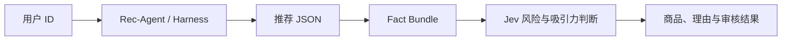

# 推荐与 Jev 独立工作流

推荐 Agent 生成商品及曝光理由，独立 Python 工作流读取推荐 JSON、构建 Fact Bundle，并调用 Jev 生成审核结果。



## 准备推荐结果

从桌面 Harness 导出最终 JSON，保存为 UTF-8 文件。也可使用仓库提供的 [`examples/harness_recommendations.json`](../examples/harness_recommendations.json)。

| 字段 | 要求 |
| --- | --- |
| `user_id` | 规范数据中存在的 `u_####` 用户 ID |
| `recommendations` | 推荐数组；未知用户可返回空数组 |
| `item_id` | 规范数据中存在的 `i_####` 商品 ID |
| `exposure_reason` / `generated_reason` | 至少提供一个；同时存在时内容相同 |
| `evidence_fields` | 支撑文案的事实字段路径 |
| `context_summary` | 推荐依据摘要 |

输入必须是完整的严格 JSON。工作流默认自动识别 Harness JSON 与候选 JSONL，也可使用 `--input-format harness` 或 `--input-format jsonl` 指定格式。用户与商品事实按 ID 从 `data/raw/` 查询。

## 准备请求

在项目根目录运行：

```bash
python3 scripts/run_recommendation_workflow.py \
  --input examples/harness_recommendations.json \
  --output-dir runs/recommendation-prepare
```

默认生成候选、事实包、请求预览和组合结果，不调用模型。每次运行请使用新的输出目录。

## 调用 Jev

在终端配置 `MODELGO_API_KEY` 后，添加 `--live`：

```bash
python3 scripts/run_recommendation_workflow.py \
  --input harness-result.json \
  --output-dir runs/recommendation-live \
  --ai-disclosure unknown \
  --live
```

`--ai-disclosure` 应与实际展示配置一致：

| 取值 | 含义 |
| --- | --- |
| `unknown` | 默认值；披露配置未确认 |
| `visible` | 已确认展示包含 AI 披露 |
| `missing` | 已确认展示缺少 AI 披露 |

每条推荐对应一次 Jev 请求，使用 `jev-questions-v4-two` 协议。风险为 `compliant` 时合规状态为 `Y`；仅合规 `Y` 且吸引力严格大于 50 时输出 `expose`，其余为 `rewrite`。详细题目、选项与评分标准见[审核协议](JEV_QUESTIONS.md)。

未知用户的空推荐正常结束，无需调用 Jev。接口或解析失败单独记录为错误，命令存在失败项时退出码为 `1`。

## 查看结果

`workflow_results.json` 将推荐与对应审核结论关联，使用两空格缩进，便于查看和集成。

| 字段 | 内容 |
| --- | --- |
| `exposure_reason` | 推荐 Agent 生成的曝光理由 |
| `audit_status` | `prepared`、`completed` 或 `error` |
| `jev_audit.risk_type` | 六类风险之一 |
| `jev_audit.attractiveness_score` | 1–100 吸引力评分 |
| `jev_audit.compliance` | 合规状态 `Y` / `N` |
| `jev_audit.decision` | 最终处置 `expose` / `rewrite` |
| `jev_audit.decision_reasons` | 处置依据 |

`prepared` 表示已准备请求，`jev_audit` 为 `null`；`completed` 表示模型已返回有效结论；`error` 的具体原因记录在错误列表中。`rewrite` 是审核结论，工作流不会自动改写文案。

### 输出文件

| 文件 | 用途 |
| --- | --- |
| `workflow_results.json` | 商品、曝光理由与审核结论 |
| `candidates.jsonl` | 规范候选与版本信息 |
| `fact_bundles.jsonl` | 商品、场景与披露事实快照 |
| `jev_requests.jsonl` | 模型请求预览 |
| `jev_responses.jsonl` | 已收到的原始响应 |
| `jev_decisions.jsonl` | 结构化审核结果 |
| `jev_errors.jsonl` | 审核失败信息（有失败时生成） |
| `workflow_report.json` | 数量、版本、调用次数与文件路径 |

## 数据契约

候选使用 `rec-candidate-v2`，规范数据版本为 `canonical-2026-06-15-v1`，场景日期为 `2026-06-15`。工作流校验身份与版本，并保留事实来源。

历史曝光点击、CTR、搜索、购物车和订单用于推荐排序；Jev 接收独立白名单内的审核事实。导出结果中的自由画像文本不替代规范数据。详见[数据说明](../data/README.md)与[审核输入说明](JEV_JUDGMENT_PROTOCOL.md)。

---

[返回项目首页](../README.md) · [可视化工作台](WEB_UI.md) · [桌面 Harness 配置](../harness-main-workspace.md)
