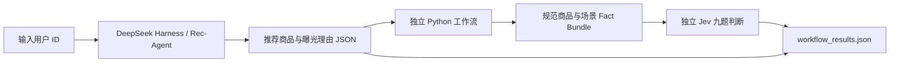

# 推荐生成与 Jev 模型处置工作流验证

日期：2026-11-18。最终处置来源为 Jev 的 `q7_final_decision.choice`；程序关联推荐与判断，校验响应格式并保存结果。

## 1. 两个阶段如何连接



DeepSeek Harness查询画像、行为和推荐反馈，生成推荐后输出严格JSON。独立程序导入这份结果、按商品加载可信事实，并在显式 `--live` 时调用Jev。Jev输出Q1–Q6、Q7、主要风险类别和严重度，程序按reason_id与原推荐关联。

Q1–Q6是不同维度判断，Q7直接决定处置；九题并行作答，Q7根据同一份state判断。最终 `decision` 与Q7保持相同，Q7自身置信度保存为 `decision_confidence`，九题最低置信度保留为 `confidence` 用于分析。

| 处置 | 本工作流中的含义 |
| --- | --- |
| expose | 模型判断可曝光，保存该结论 |
| rewrite | 模型判断需要改写，保存该结论 |
| human_review | 模型判断建议人工复核，保存该标签 |
| block | 模型判断应拦截，保存该结论 |

当前工作流到组合结果输出为止。`human_review` 不代表已经进入实际人工任务，`rewrite` 不自动启动改写；实际商品展示也未由审核脚本执行。`escalated`仅为兼容布尔标记，表示处置是否等于human_review。

## 2. 当前结果文件

`workflow_results.json`采用两空格缩进，将每条商品和模型判断放在一起：

```json
{
  "schema_version": "recommendation-jev-workflow-v1",
  "mode": "live",
  "decision_source": "jev_model",
  "recommendations": [
    {
      "reason_id": "r_example",
      "user_id": "u_0001",
      "item_id": "i_0001",
      "title": "规范商品标题",
      "exposure_reason": "折叠收纳，35L大容量更省心",
      "generated_reason": "折叠收纳，35L大容量更省心",
      "evidence_fields": ["items.spec", "items.functions"],
      "context_summary": "使用商品规格与折叠收纳功能",
      "audit_status": "completed",
      "jev_audit": {
        "decision": "expose",
        "decision_source": "jev_model",
        "decision_question": "q7_final_decision",
        "decision_confidence": 0.91
      }
    }
  ],
  "errors": []
}
```

示例省略jev_audit其余字段。实际输出保留完整逐题选择、置信度、风险、严重度、事实引用和披露配置注记。原始响应、请求和Fact Bundle另存，便于逐项复查。

`audit_status`表示程序是否完成本条模型判断：prepared为只准备、completed为已得到有效模型结论、error为请求或解析失败。模型选择human_review时仍为completed。接口或格式失败则 `jev_audit:null`，原因单列errors。

## 3. 保存响应的回放验证

源目录为 `runs/2026-11-18-q2-v2-live/`，其中172条响应来自此前真实 `jev-1.14.0` API调用。本次使用同一批原始响应重新解析，**新增网络调用为0**；没有重新启动DS生成，也没有声称重新调用Jev。

回放校验冻结的完整请求，包括文案、身份、事实、题目、模型和追踪字段；同时校验完整facts哈希和原始响应元数据。输出写入新目录，历史运行文件保留。

| 分组 | 有效结果 | expose | rewrite | human_review | block |
| --- | ---: | ---: | ---: | ---: | ---: |
| 新Q2题目，40条×2次 | 80 | 44 | 21 | 5 | 10 |
| 旧Q2对照，40条×2次 | 80 | 44 | 22 | 4 | 10 |
| 原六条DS推荐 | 6 | 6 | 0 | 0 | 0 |
| 披露状态控制 | 6 | 4 | 2 | 0 | 0 |
| 合计 | 172 | 98 | 45 | 9 | 20 |

最新完整请求绑定回放产物：`runs/2026-11-18-jev-model-decisions-bound/summary.json`、`runs/2026-11-18-jev-model-decisions-bound/decisions.jsonl`、`runs/2026-11-18-jev-model-decisions-bound/comparison_results.csv`。

逐条核对：172条最终decision与原始Q7不一致的数量为0；有效解析172条，错误0条。human_review一列只是模型标签计数。

两组的Q2仍有差异，但Q7建议曝光均44次。过去报告里“最终曝光13→23”等数字包含当时的本地汇总策略，不能用来描述当前工作流；历史记录已标注对应运行语义。当前数字直接取模型Q7。

## 4. 原六条组合结果

本次复用此前DS桌面端输出的两名用户各三条推荐；Jev原始响应均选择expose，因此组合结果保留expose。

| 用户 / 商品 | Jev Q7 | Q7置信度 | 最低题目置信度 | 保存的decision |
| --- | --- | ---: | ---: | --- |
| u_0001 / 大米 | expose | 0.77 | 0.45 | expose |
| u_0001 / 口红 | expose | 0.89 | 0.55 | expose |
| u_0001 / 抽纸 | expose | 0.85 | 0.37 | expose |
| u_0199 / 手环 | expose | 0.93 | 0.85 | expose |
| u_0199 / 短袖 | expose | 0.93 | 0.77 | expose |
| u_0199 / 炒锅 | expose | 0.72 | 0.49 | expose |

不存在的用户u_9999仍为空推荐，结果为空列表，模型调用为0。

可读组合文件：

- `runs/2026-11-18-harness-jev-workflow-model/workflow_results.json`。
- `runs/2026-11-18-harness-jev-workflow-model/u_0001/workflow_results.json`。
- `runs/2026-11-18-harness-jev-workflow-model/u_0199/workflow_results.json`。
- `runs/2026-11-18-harness-jev-workflow-model/u_9999/workflow_results.json`。

模型处置是审核输出，并不证明这些文案都正确。例如两条缺材质样本仍出现Q2 supported、Q7 expose；咖啡missing控制出现risk_type为披露缺失但Q7 expose。当前输出会如实保留这类题间不一致，便于后续评价模型。独立人工标注模板仅用于可选离线评价模型质量，不是本工作流的执行环节。

## 5. 验证范围

验证结果：全量 **287 passed**；规范数据硬校验 `PASS: all hard checks passed`；Python编译检查与 `git diff --check` 通过。

自动化回归覆盖：四种模型处置原样输出；低置信度、严重度、Q1–Q6、规则线索与披露配置均保持模型处置；prepare模式零网络；原始响应先落盘；格式失败单独报错；组合结果按reason_id连接；冻结请求防文案漂移；重跑拒绝覆盖。

数值、ID、模型、协议版本、重复JSON键及无效JSON常量均校验，失败作为错误，不生成模型处置。规范输入边界继续限制历史点击/CTR等只供推荐阶段参考，Jev只接收受限的当前事实。

完整题目原文见 [Jev问题清单](JEV_QUESTIONS.md)，运行方法见 [独立工作流](STANDALONE_WORKFLOW.md)。本地runs产物按项目Git配置不纳入仓库。

## 6. 使用命令

把DeepSeek Harness最终推荐保存为 `harness-result.json` 后，在项目根目录运行：

```bash
python3 scripts/run_recommendation_workflow.py \
  --input harness-result.json \
  --output-dir runs/recommendation-live-new \
  --live
```

该终端需已设置MODELGO_API_KEY。不加 `--live` 时只生成准备产物，`jev_audit`为null；每次运行选新输出目录。完成后查看该目录的 `workflow_results.json`。

回放已有模型响应：

```bash
python3 scripts/replay_jev_model_decisions.py \
  --comparison-dir runs/2026-11-18-q2-v2-live \
  --output-dir runs/jev-model-replay-new
```
