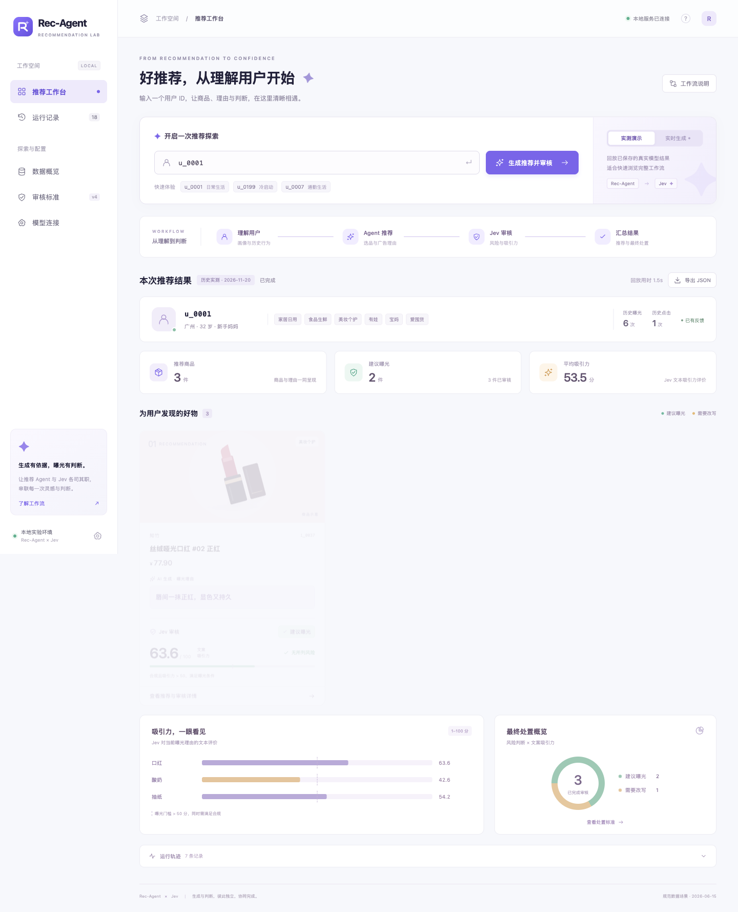

# 可视化工作台测试记录

日期：2026-11-20。使用规范模拟数据，固定业务日期 2026-06-15。实时测试模型为 `deepseek-v4-flash`（ModelGo 推荐路由）与 `jev-1.14.0`（独立审核），协议 `jev-questions-v4-two`。

## 已验证功能

| 项目 | 结果 |
| --- | --- |
| 用户 ID 输入、快捷示例和阶段状态 | 通过 |
| 推荐商品、价格、AI 曝光理由与 Jev 同卡展示 | 通过 |
| 三组保存的真实推荐与审核结果演示 | 通过；回放不调用模型 |
| 吸引力横条、门槛线和处置环图 | 通过 |
| 审核详情、完整精度评分、风险概率、证据与 JSON | 通过 |
| 抽屉与弹窗、Escape 关闭、焦点恢复 | 通过 |
| 运行记录列表及重新查看 | 通过 |
| 记录落盘、服务重启恢复与中断标记 | 通过；中断任务不自动续发请求 |
| 浏览器下载完整结果 JSON | 通过；下载文件严格解析成功 |
| 不存在用户 u_9999 | 0 推荐、0 推荐模型调用、0 Jev 调用 |
| 1440px 桌面与 390px 手机布局 | 已截图检查；均无横向溢出 |
| 后端接口与状态逻辑测试 | 13 项通过 |
| Python 全量测试 | 520 passed |
| 桌面输出插件回归测试 | 10 passed |
| 规范数据硬检查 | PASS |

浏览器使用 Playwright 真实点击验证演示、改写标签、详情、精确评分、Escape、下载、响应式布局、记录重开、未知用户和协议弹窗。自动检查中修正了测试等待与定位方式，最终整条检查通过。商品插画为示意，不是真实商品照片。

## 两轮实时链路

以下两轮是修复后选取的实时验证，均由新推荐输出进入独立 Jev 阶段；不是回放样例，也不表示所有开发期间的请求均成功。

| 用户 | 推荐模型请求 | Jev 请求 | 完成耗时 | 曝光 / 改写 | 平均吸引力 |
| --- | ---: | ---: | ---: | --- | ---: |
| u_0199 | 1 | 3 | 8.47 秒 | 2 / 1 | 54.79 |
| u_0001 | 1 | 3 | 7.04 秒 | 3 / 0 | 56.51 |

| 用户 | 商品 ID | 本轮真实生成理由 | Jev 风险选择 | 吸引力 | 处置 |
| --- | --- | --- | --- | ---: | --- |
| u_0199 | i_0111 | 抬腕看心率，走路更有数 | compliant | 57.21 | expose |
| u_0199 | i_0016 | 少油烟炒菜，锅底不粘更顺手 | compliant | 57.32 | expose |
| u_0199 | i_0001 | 换季收纳，折叠起来省地方 | compliant | 49.84 | rewrite |
| u_0001 | i_0036 | 豆沙色丝绒哑光，通勤一抹显气色 | compliant | 62.60 | expose |
| u_0001 | i_0066 | 云南蓝莓正当季，洗洗就能吃 | compliant | 50.83 | expose |
| u_0001 | i_0020 | 麦饭石炒锅，少油烟不粘好开火 | compliant | 56.11 | expose |

所有保存结果按 `risk_type=compliant AND score>50` 重算，与最终处置一致。Jev 的历史点击输入隔离沿用项目协议；新网页将 AI 生成标识直接显示在商品卡上，实时请求使用 `disclosure=visible`。演示保留原始审核时的 `unknown` 状态，不重写历史结论。

这六条文案和审核结果是模型行为观察，没有独立人工金标，不表示事实审核准确率或真实点击率。例如“抬腕看心率”仍可能暗示资料未明确提供的查看能力；当前六类风险不提供单独的通用事实支持结论，三次判合规不能替代完整事实核验。

## 真实联调中修复的问题

最初的推荐请求发生 HTTP 成功但 JSON 为空：响应的 `finish_reason=length`，1600 个输出 token 全部用于推理，最终 `content` 为空。重复商品 brief 也扩大了输入。

修复后共享场景和边界指令只发送一次，使用 JSON 输出模式、DeepSeek 关闭推理配置与有界输出预算（8192，必要时第二次 16384）。最多两次尝试，截断时拒绝发布不完整 JSON；错误不会降级成演示结果或伪造 Jev 结论。保留不含密钥的请求、响应和诊断数据。

本机运行产物位于 `runs/web-ui/<run_id>/`，被 Git 忽略。上述两轮 ID 分别为 `549d77e466414fe89e67de9eab8ca6aa`、`aea1ba8bd59d41748e0dfe898a08213b`。浏览器检查产物位于 `output/playwright/`。测试凭据仅注入服务进程环境，没有写入源码、样例或文档。

## 页面预览

[桌面完整预览](assets/web-ui-desktop.png) · [手机完整预览](assets/web-ui-mobile.png)

启动与配置见[可视化工作台说明](WEB_UI.md)。
