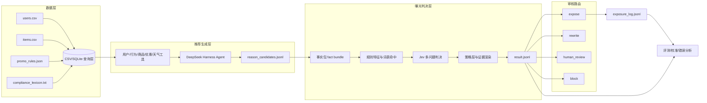

# 推荐理由曝光审核项目基线与技术方案

> 文档版本：v2.0（两份项目梳理文档合并版）
>
> 文档状态：后续实现、评测和项目包装的基线
>
> 更新时间：2026-11-16
>
> 参考文档：`推荐理由曝光审核-一页纸.md`、`项目梳理-Jev曝光审核.md`

## 1. 一句话定位

这不是一个单纯的推荐文案生成项目，而是一套**曝光前推荐理由合规判决系统**：

```text
Agent 决定“推什么、怎么写”
Jev 决定“能不能发、怎么处置、凭什么”
曝光日志决定“判得准不准”
```

项目围绕淘宝“猜你喜欢”推荐卡片展开。系统先根据用户画像、近期行为、商品属性、优惠规则和场景信息生成商品及个性化推荐理由，再由 Jev 在曝光前完成事实一致性与合规判决，最后使用曝光后的点击、订单、退款和投诉数据验证判决分数是否具有校准意义。

## 2. 事实口径与当前状态

### 2.1 术语口径

会议记录中的“Java 模型”按项目上下文统一解释为 **Jev 模型**。一页纸中出现的 `model_version=jev-1.14.0` 和 `score_name=jev-compliance-v1` 是当前输出契约中的版本示例。

Jev 是判决器和评分器，不是推荐理由生成器，也不是通用文案润色器。

### 2.2 当前已存在的文件

当前工作区已经生成：

- `users.csv`：200 条用户数据；
- `items.csv`：200 条商品数据；
- `promo_rules.json`：已生成 30 条 Mock 促销规则；
- `compliance_lexicon.txt`：已生成 72 条教学用词表记录；
- `reason_candidates.jsonl`：已生成 40 条 pilot 候选理由；
- `dev_labels.csv`：已生成 40 条 pilot 金标记录；
- `reason_candidates_full.jsonl`：已生成 300 条全量候选（200 natural + 100 stress）；
- `dev_labels_full.csv`：已生成 300 条 synthetic/silver 标签，待独立人工复核；
- `generate_mock_data.py`：使用固定随机种子生成两张基础表；
- `generate_review_assets.py`：生成促销规则和合规词表；
- `generate_pilot_candidates.py`：生成 20 用户、20 商品、40 候选的纵向切片；
- `generate_full_candidates.py`：生成 200 natural + 100 stress 的全量模板候选；
- `modelgo_agent.py`：ModelGo DeepSeek fallback Agent 客户端；
- `generate_agent_candidates.py`：批量生成 Agent natural 候选；
- `agent_generation_report.json`、`agent_quality_report.json`：Agent 生成质量和运行报告；
- `reason_candidates_agent_natural.jsonl`、`reason_candidates_agent_full.jsonl`：Agent 生成候选；
- `fact_bundle_agent_full.jsonl`：Agent 候选事实包；
- `run_rule_baseline.py`：运行纯规则判决和 pilot 指标评测；
- `result_rule_baseline.jsonl`：40 条规则基线结果；
- `result.jsonl`：当前全量活动结果文件，内容为 300 条真实 Jev 结果；
- `rule_baseline_report.json`：规则基线指标报告；
- `result_rule_baseline_full.jsonl`、`rule_baseline_full_report.json`：300 条全量规则基线结果；
- `fact_bundle.jsonl`：40 条 canonical Jev 事实包；
- `fact_bundle_full.jsonl`：300 条全量 Jev 事实包；
- `result_jev_full.jsonl`、`jev_batch_full_report.json`：300 条真实 Jev 结果和批处理报告；
- `fact_bundle.py`：事实包构造和来源追踪脚本；
- `jev_adapter.py`：支持 SystemOne 协议和 dry-run 的可替换 Jev HTTP Adapter；
- `run_jev_batch.py`：Jev 批处理、错误隔离和延迟统计脚本；
- `result_jev.jsonl`：40 条真实 Jev 结果；
- `jev_batch_report.json`：真实 Jev pilot 的延迟、错误和评测报告；
- `jev_errors.jsonl`：Jev 批处理错误记录，目前为空；
- `compare_baselines.py`：规则基线与 Jev 的逐条对照脚本；
- `baseline_comparison_report.json`、`baseline_comparison_report.md`：规则与 Jev 的 pilot 对比报告；
- `error_analysis_report.md`：Jev 不一致样本和策略迭代记录；
- `evaluate_exposure.py`：曝光行为生成和分桶校准脚本；
- `exposure_log.jsonl`：40 条模拟曝光行为记录；
- `latent.csv`：仅供评测使用的模拟隐变量和潜在结果；
- `calibration_report.json`：pilot 退款率、投诉率和成交率的分数分桶报告；
- `exposure_log_full.jsonl`、`latent_full.csv`：300 条全量模拟曝光行为和评测隐变量；
- `calibration_full_report.json`：全量分数分桶与行为指标校准；
- `baseline_comparison_full_report.json`、`baseline_comparison_full_report.md`：300 条规则/Jev 对照报告；
- `jev_request_preview.json`：第一条事实包的请求预览；
- `tests/test_rule_baseline.py`、`tests/test_fact_bundle.py`、`tests/test_jev_adapter.py`：规则、事实包和 Adapter 测试；
- `用户与商品数据说明.md`：两张基础表的字段说明。

主工作区现已统一包含 `data/raw/`、`data/mock.db`、`mcp_server.py`、`rec-agent-preset/` 和 `rec-agent-mcp/`。Harness profile 已指向主目录，并通过 `stdio` 注册 `rec-agent-data` MCP 服务；工具名形如 `mcp__rec-agent-data__get_user_profile`。Jev 的 ModelGo SystemOne 接口已经用一条脱敏事实包完成真实冒烟和 40 条 pilot 批处理验证。

### 2.3 当前默认实现模式

当前采用“规则基线 + SystemOne Jev Adapter”的实现：

- 规则层负责可解释硬规则和基线对照；
- `JevAdapter` 使用 `https://api.modelgo.ai/v1/systemone`；
- 输入使用 `state + questions`，输出从 `answers` 映射到项目结果 Schema；
- 对 `unverifiable/conflict` 事实和缺少 AI 披露执行确定性安全路由；
- DeepSeek Harness 仍保持可替换，后续再接入推荐 Agent。

如果未来切换到 surrogate，报告必须明确说明实际使用的是代理判决器，不能把代理模型冒充为线上 `jev-1.14.0`。

文档中提到的广告法条款、监管通知和公开报道只作为场景背景或教学词表来源。正式实现前应单独核验来源、版本和适用范围，不能把背景文字直接当作模型事实或正式法务结论。

## 3. 业务背景与目标

### 3.1 业务背景

纯商品推荐往往不能解释“为什么推荐给我”。加入“杭州梅雨季防潮神器”“给中考完孩子的礼物”等理由，可以把商品和用户的地域、时间、兴趣或行为联系起来，提高推荐卡片的理解度和点击意愿。

但生成式推荐需要为大量用户逐条生成理由，人工逐条审核不可行。通用大模型逐条预审又存在成本高、延迟高、输出不稳定和证据难审计等问题。因此项目引入 Jev 作为曝光前判决闸门。

此外，文案本身可能没有明显违规，但曝光后退款率、差评率或投诉率偏高。只看文案或只看判决分数都不能完整识别这种风险，需要用曝光后日志做质量反馈和分数校准。

### 3.2 项目目标

1. 建立从 `user_id` 到推荐商品、推荐理由和结构化推荐卡片的 Agent 链路。
2. 建立从推荐卡片到 Jev 判决结果的曝光前审核链路。
3. 输出可审计的四档处置、六类风险、证据、分数、版本和升级标记。
4. 构建规则、Jev、生成式评审三档同口径基线。
5. 用曝光后行为检验 `judge_score` 与退款率、投诉率、成交率之间的关系。
6. 在 Mock 数据条件下形成可复现、可解释、可用于面试讲解的项目闭环。

### 3.3 项目不做什么

- 不重做生产召回和排序。
- 不训练或重训推荐模型。
- 不把 Jev 设计成通用文案润色器。
- 不做真实法务认定；`block` 表示“不进入曝光流程”，不等同于正式违法结论。
- 不使用真实用户、真实商品或生产数据。
- 不把曝光后的退款、投诉结果直接泄漏到曝光前判决输入。
- 不通过把所有样本都判为 `block` 来刷低违规漏放率。

## 4. 端到端项目链路



### 4.1 推荐生成链路

1. 接收 `user_id`。
2. 查询用户画像、地域、兴趣、近期类目、购买历史、购物车、活跃时段和可用的会话上下文。
3. 查询商品类目、功能、材质、适用场景、价格、库存和促销关联关系。
4. 根据用户偏好做可解释的候选筛选。Demo 可以使用规则过滤或简单排序，生产召回与排序不在本项目范围内。
5. Agent 生成一张包含商品和个性化推荐理由的卡片。
6. 保存上下文快照、商品快照、理由、生成模式和 `tool_trace`。

### 4.2 曝光审核链路

1. 接收待曝光候选理由。
2. 读取用户上下文、商品事实、促销计算、合规词表、AI 披露标记和工具轨迹。
3. 将原始候选整理为结构化事实包。
4. 计算确定性特征，例如绝对化词命中、功效词命中、属性支撑、价格条件、主题相关性和字段完整性。
5. 调用 Jev 的多个判决问题或本地代理判决器。
6. 用策略层确定四档处置和主风险类型。
7. 由代码生成证据，并验证证据引用确实存在于输入中。
8. 保存结果、版本和轨迹，路由到曝光、改写、人审或拦截。

### 4.3 曝光后评测链路

1. 记录每条理由的曝光量、点击、加购、下单、退款、投诉和人工工单。
2. 使用 `reason_id` 关联曝光前结果与曝光后行为。
3. 按 `judge_score` 分桶观察退款率、举报率和成交率。
4. 报告全量模拟口径和仅曝光子集口径，说明选择偏差。
5. 对比规则、Jev、生成式评审和可选级联方案。

## 5. 组件职责边界

| 组件 | 负责内容 | 不负责内容 |
|---|---|---|
| 推荐 Agent | 查询上下文、选择候选商品、生成推荐理由、保存工具轨迹 | 最终合规判定、替代人工审核、绕过判决直接曝光 |
| 工具层 | 查询用户、商品、促销、词表、天气、历史表现 | 凭空生成不存在的商品事实 |
| 事实包层 | 汇总与裁剪输入，记录字段完整性 | 修改原始商品事实 |
| 规则特征层 | 词表、属性、价格、主题、披露和完整性特征 | 独立承担所有语义判定 |
| Jev | 对多个审核问题打分，输出风险判断 | 重新召回商品、重训推荐模型、润色文案 |
| 策略层 | 聚合分数、确定处置、生成升级信号 | 隐藏证据或改写模型分数 |
| 证据层 | 从真实输入字段渲染可审计证据 | 自由编造解释 |
| 路由层 | 执行曝光、改写、人工审核和拦截 | 绕过 `block` 或空证据曝光 |
| 评测层 | 计算指标、校准、错误分析和成本延迟 | 把曝光后信息泄漏到曝光前请求 |

## 6. 数据资产与数据契约

### 6.1 数据文件

| 文件 | 状态/规模 | 用途 |
|---|---:|---|
| `users.csv` | 已有 200 条 | 用户画像、地域、兴趣、购买历史、购物车和活跃时段 |
| `items.csv` | 已有 200 条 | 商品类目、功能、材质、场景、价格、库存、活动和风险标签 |
| `promo_rules.json` | 已生成 30 条 | 满减、折扣、优惠券、赠品和适用范围 |
| `compliance_lexicon.txt` | 已生成 72 条 | 绝对化、功效/医疗和价格误导词表 |
| `reason_candidates.jsonl` | 已生成 40 条 pilot | 模板试点候选 |
| `dev_labels.csv` | 已生成 40 条 pilot | 试点事实支持、风险类型、处置结论、证据和置信度 |
| `reason_candidates_full.jsonl` | 已生成 300 条 | 200 条 natural + 100 条 stress，全量模板候选，待 Agent 替换 |
| `dev_labels_full.csv` | 已生成 300 条 synthetic/silver | 全量初始标签，需独立人工复核 |
| `exposure_log.jsonl` | 已生成 40 条 | 模拟曝光后的点击、加购、订单、退款和投诉 |
| `result_rule_baseline.jsonl` | 已生成 40 条 | pilot 规则基线结果 |
| `result_rule_baseline_full.jsonl` | 已生成 300 条 | 全量规则基线结果 |
| `result_jev.jsonl` | 已生成 40 条 | pilot 真实 Jev 结果 |
| `result_jev_full.jsonl`、`result.jsonl` | 已生成 300 条 | 当前活动结果为全量真实 Jev 结果；规则结果保存在 `result_rule_baseline_full.jsonl` |
| `rule_baseline_report.json` | 已生成 | 规则基线的漏放率、宏 F1、风险准确率和证据完整性 |
| `fact_bundle.jsonl` | 已生成 40 条 | Jev 唯一事实输入，包含快照、provenance 和可验证性状态 |
| `baseline_comparison_report.json`、`baseline_comparison_report.md` | 已生成 | 规则基线与 Jev 的指标和不一致样本 |
| `latent.csv` | 已生成 40 条 | 仅供评测使用的 DGP 隐变量，不进入 Jev 输入 |
| `calibration_report.json` | 已生成 | `judge_score` 分桶与行为指标校准 |
| `rewrite_suggestions.jsonl` | 可选 | `rewrite` 的改写操作和改写文案 |

### 6.2 当前基础表与后续扩展

当前 `users.csv` 和 `items.csv` 已能支撑基础推荐链路。为了支持更完整的 Jev 判决和曝光回放，后续可以新增或派生以下字段：

**用户侧扩展**：`city_tier`、`climate_zone`、`life_stage`、`member_level`、`account_age_days`、`aov_90d`、`orders_90d`、`price_sensitivity`、`night_owl`、`last_search_terms`、`tags`。

**商品侧扩展**：`efficacy_claims_allowed`、`qualifications`、`regulated_category`、`sensitive_category`、`sales_30d`、`rating`、`return_rate_30d`、`complaint_rate_30d`。

这些字段可以：

- 直接扩展 CSV；
- 放入单独的 `user_context` 或 `item_compliance_attrs` 文件；
- 在候选生成时作为派生字段写入快照。

在没有实际扩展前，不能在 Agent 或 Jev 中假设这些字段已经存在。

### 6.3 关系键

```text
users.user_id
    └── reason_candidates.user_id

items.item_id
    ├── users.purchase_history_item_ids
    ├── users.cart_item_ids
    └── reason_candidates.item_id

items.promo_ids
    └── promo_rules.promo_id

reason_candidates.reason_id
    ├── dev_labels.reason_id
    ├── exposure_log.reason_id
    └── result.reason_id
```

### 6.4 候选理由建议规模

首版建议生成 300 条：

- 200 条自然候选，尽量做到每个用户至少 1 条；
- 100 条压力候选，由自然候选派生绝对化、功效夸大、价格误导、主题错配、字段缺失或变体规避样本。

在真正生成 300 条前，先使用 20 用户、20 商品、40 条候选做纵向切片，先打通全链路，再放大数据规模。

### 6.5 快照、来源和版本

用于 Jev 的事实必须冻结为可回放快照。事实包和候选记录建议额外保留：

- `snapshot_at`：事实快照时间；
- `data_version`：用户、商品、促销和词表版本；
- `agent_version`：Agent 或 prompt 版本；
- `source`：字段来自哪个文件、工具或规则；
- `tool_trace`：工具名、入参摘要、返回字段、耗时和结果哈希；
- `provenance`：字段路径到原始数据的映射。

Jev 不应在判决过程中自行补全事实。若来源缺失、过期或相互矛盾，应进入可验证性状态并升级，而不是默认当作合规。

### 6.6 数据质量门禁

实现 `scripts/validate_data.py` 或等价检查脚本，至少验证：

1. 所有 `user_id`、`item_id`、`promo_id` 都能关联。
2. 用户和商品数量符合当前版本要求。
3. 候选理由与标签一一对应。
4. 每条候选至少拥有两个可引用事实字段。
5. `item_attrs_returned` 不为空，字段完整性明确记录。
6. 六类风险和四类处置均有覆盖，不能只有 `compliant`。
7. 价格和促销候选达到预设覆盖比例。
8. 不包含手机号、真实姓名、真实地址等 PII。
9. 商品标签和风险种子不直接作为 Jev 的输入结论。
10. 所有 CSV、JSON 和 JSONL 均可被脚本解析。

建议把门禁分成五层，任何失败都不能静默降级为 `expose`：

| 门禁 | 检查内容 | 失败处理 |
|---|---|---|
| G0 文件门禁 | 编码、JSON/JSONL 解析、表头、主键、重复记录 | 阻断数据集或该批任务 |
| G1 关联门禁 | `user_id`、`item_id`、`promo_id` 外键和快照存在 | 单条候选 `human_review + escalated=true` |
| G2 事实门禁 | 字段类型、价格/库存、活动有效期、AI 标记来源、数据新鲜度 | 内部 `verification_state=unverifiable` |
| G3 判决门禁 | 四档 decision、六类 risk、分数范围、证据引用白名单、reason_id 一一对应 | 重试；仍失败则禁止写入可曝光结果并转人工 |
| G4 评测门禁 | 用户/时间切分、行为字段隔离、dev/test 封存、标签版本一致 | 评测作废，不能提交指标 |

### 6.7 数据隔离与防泄漏

- 生成 Agent 不读取人工标签、隐藏风险种子、测试集答案和合规判决结果。
- Jev 只能读取候选事实包，不能读取 `gold_decision`、`risk_seed` 或评测脚本中的隐变量。
- `exposure_log.jsonl` 中的点击、订单、退款、投诉和人工工单只进入评测与校准，不进入曝光前事实包、提示词、缓存或阈值拟合。
- `history_reason_stats` 只能使用曝光时间之前的历史窗口，并记录 cutoff 时间和数据版本。
- dev/test 按用户或时间隔离，test 集在问题定义、提示词、阈值和特征选择冻结后才使用。
- `risk_tags` 是场景覆盖辅助字段，不得直接作为金标或 Jev 输入结论。

## 7. N0：口径与标注体系

### 7.1 标注目标

先定义“什么情况应当 block、什么情况可 rewrite、什么情况必须 human_review”，再开始大批量标注，否则后续阈值和评测会反复返工。

建议建立 `label_spec_v1.md`，包括：

- 六类风险的定义；
- 每类至少两个正例和两个反例；
- 多风险并存时的优先级；
- 10 个边界样本；
- 证据填写规范；
- 金标和 silver 标注的区别。

### 7.2 双标与一致性

抽取约 10% 样本做双人独立标注，用 Cohen's κ 评估一致性。分歧由第三方仲裁，并将结论写回标注手册。

建议目标：

- κ ≥ 0.8；
- `block` 样本 100% 复核；
- 测试集只在口径冻结后生成。

## 8. Jev 输入设计：事实包

Jev 不直接接收未经整理的全量候选，而是接收结构化事实包。事实包的每个字段都必须有明确的下游用途。

```json
{
  "schema_version": "fact-bundle-v2",
  "reason_id": "r_00001",
  "user_id": "u_0001",
  "item_id": "i_0001",
  "exposure_reason": "广州租房收纳，35L折叠盒更省空间",
  "generated_reason": "广州租房收纳，35L折叠盒更省空间",
  "evidence_fields": ["users.city", "items.spec"],
  "user_context": {"city": "广州", "city_tier": "一线", "life_stage": "新手妈妈"},
  "item": {
    "item_id": "i_0001",
    "category_l1": "家居日用",
    "functions": ["折叠", "防尘", "收纳"],
    "spec": "35L 奶油白",
    "price_cents": 5790,
    "qualifications": ["无"]
  },
  "promo": {"promo_id": "P010", "applicable": true},
  "lexicon_hits": [],
  "disclosure": {"flag": true, "required": true},
  "verification_state": "verified",
  "coverage": {"missing": [], "complete": true},
  "provenance": {"item": "data/raw/items.csv:item_id=i_0001"},
  "data_version": "canonical-2026-06-15-v1"
}
```

字段与判决问题的对应关系：

| 输入字段 | 主要用途 |
|---|---|
| `exposure_reason` | 用户可见的一句话推荐文案；文本解析、词表命中、主张抽取 |
| `generated_reason` | 与 `exposure_reason` 相同的兼容字段 |
| `user_context` | 仅保留与当前理由直接相关的城市、气候、人群和场景 |
| `item` | canonical 商品属性支撑和反证，ID 固定为 `i_####` |
| `coverage` | 判断“没查到”还是“确实不存在” |
| `promo` | 价格和优惠数字核验 |
| `lexicon_hits` | 绝对化、功效/医疗和价格词命中 |
| `disclosure` | AI 披露是否缺失 |
| `provenance` / `data_version` | 判断事实来源、版本和可回放性 |

点击历史、CTR、订单、退款、投诉、购物车、搜索词和排序信号禁止进入 Jev 输入；它们只属于 Rec-Agent 的排序或曝光后分析链路。

### 8.1 可验证性状态

事实包内部建议使用 `verification_state`，但不扩展正式的六类 `risk_type`：

| 状态 | 含义 | 默认处理 |
|---|---|---|
| `verified` | 关键字段、来源和版本齐全，证据可以锚定 | 正常进入判决 |
| `unverifiable` | 关键字段缺失、来源过期或工具返回不完整 | `escalated=true`，默认 `human_review` |
| `conflict` | 规则、商品快照、工具结果或模型问题之间冲突 | `escalated=true`，默认 `human_review` |
| `not_applicable` | 某个问题对当前样本不适用 | 不因该问题单独升级 |

硬性违规且证据已经验证时，仍按六类风险和 `block` 处理；只有在“无法确认”时才使用 `unverifiable` 路由。曝光后行为和人工工单不能写入事实包的前置字段。

## 9. Jev 判决问题设计

不要只使用一个“是否合规”的大问题。当前 `jev-questions-v1` 固定为七步结构化协议：

| 编号 | 判决问题 | 输出 | 主要用途 |
|---|---|---|---|
| Q1 | 候选身份、商品 ID、版本和事实包是否一致？ | `valid / invalid / unverifiable` | 防止错商品、错版本和不可追溯输入 |
| Q2 | 推荐理由是否被商品或场景事实直接支持？ | `supported / partial / unsupported / unverifiable` + evidence | 逐句核验事实支撑 |
| Q3 | 是否存在绝对化、功效/医疗、价格误导、披露缺失或跑题表达？ | `clean / rewriteable / blocking` + risk type | 区分可改写和硬风险 |
| Q4 | 价格、折扣、满减、赠品和有效期是否与快照一致？ | `verified / mismatch / not_mentioned / unverifiable` | 商业事实核验 |
| Q5 | 最小用户场景摘要与商品是否相关？ | `relevant / off_topic / unverifiable` | 防止无依据个性化 |
| Q6 | 是否需要安全门禁或人工审核？ | `pass / human_review / fail` + escalation reason | 处理缺字段、冲突、敏感类目和低置信度 |
| Q7 | 综合前六问的最终处置是什么？ | `decision / risk_type / score / confidence / evidence / escalated` | 输出 `expose / rewrite / human_review / block` |

判决问题设计遵循三条纪律：

1. 一次只问一件事，不使用含义混杂的“大而全”问题。
2. 问事实支持，不直接要求模型做法律定性。
3. 每个问题都准备正反例，避免模型学成“看到功效词就一律拦截”。

### 9.1 `unverifiable` 的内部使用规则

原始任务的正式 `risk_type` 只有六类，因此 `unverifiable` 默认只作为内部状态：

- 关键商品属性缺失导致无法判断功效：外部映射为 `efficacy_or_medical_claim`，`decision=human_review`，证据说明字段缺失；
- 促销字段缺失导致无法核验价格：外部映射为 `price_misleading`，`decision=human_review`；
- 用户或场景字段缺失导致无法判断主题：外部映射为 `off_topic`，`decision=human_review`；
- 其他无法归类的缺失：使用项目定义的默认映射，并在 `evidence` 说明原因。

如果后续评测允许扩展 Schema，可以将 `unverifiable` 加入内部或扩展输出，但不能在未确认前破坏原始六类接口。

## 10. 处置策略与分数聚合

### 10.1 四档处置语义

| `decision` | 含义 | 默认触发条件 |
|---|---|---|
| `block` | 不进入曝光流程 | 事实性违规且不可机械修复，如无属性支撑的功效、严重价格误导 |
| `rewrite` | 改写后重新审核 | 删除绝对化词、补 AI 标识、修正价格数字或替换不实形容词后可修复 |
| `human_review` | 进入人工合规队列 | 字段缺失、证据冲突、低置信度、敏感类目新宣称 |
| `expose` | 直接曝光 | 无风险命中、证据充分且风险分低于阈值 |

### 10.2 多风险优先级

先确定 `decision`，再确定主 `risk_type`。基线优先级如下：

1. `price_misleading`；
2. `efficacy_or_medical_claim`；
3. `absolute_claim`；
4. `missing_ai_disclosure`；
5. `off_topic`；
6. `compliant`。

如果一条理由同时命中多个风险，只输出一个主风险类型，但在 `evidence` 中保留所有重要依据。

### 10.3 建议的决策顺序

```text
1. 硬规则命中且证据充分 → block
2. 关键字段缺失且无法排除高风险 → human_review + escalated=true
3. 功效/医疗风险高且属性或资质不支持 → block
4. 价格差异超过容差 → block；模糊表述 → rewrite
5. 绝对化表达可删除或替换 → rewrite；删改后语义不成立 → block
6. 缺少 AI 披露 → rewrite，除非业务规则要求直接拦截
7. 主题不符但可以重写 → rewrite；证据不足 → human_review
8. 其余且风险分低于曝光阈值 → expose
9. 分数处于中间带或多个问题冲突 → escalated=true，进入二级复核
```

阈值只允许在 dev 集上选择，并在 test 集冻结。目标不是单纯追求低漏放，而是在漏放率为 0 的前提下，尽量降低误杀率和人工量。

### 10.4 `judge_score` 和 `escalated`

- `judge_score`：定义为 `P(不安全)`，范围 `0~1`，越高风险越大。
- `escalated`：表示是否进入二级复核通道，不等于最终 `human_review`。
- 低置信、问题冲突、字段不完整或敏感类目未明确合规时，可以设置为 `true`。
- 具体阈值必须配置化、版本化，不写死在提示词中。

## 11. 证据生成规范

证据必须由代码根据真实输入字段渲染，模型只负责打分和风险判断。

有效证据示例：

```text
item_attrs_returned.functions=['折叠','防尘'] 不含「防潮/除湿」
promo P003 规则为满199减50，当前计算结果 applicable=false
lexicon term=「顶级」命中 absolute_claim 词表
ai_disclosure_flag_from_code=false
get_item 已返回 functions，理由仍宣称防潮
```

无效证据示例：

```text
该商品涉嫌违法宣传
模型认为风险很高
这句话看起来不太合规
```

实现 `validate_evidence.py` 或等价校验器，检查：

- 引用字段路径是否存在；
- 引用值是否与原始输入一致；
- 词表条目是否真实命中；
- 规则 ID 是否存在；
- 每条结果的 `evidence` 是否非空。

目标：证据有效率 100%。

### 11.1 证据引用白名单

证据引用建议使用稳定路径，避免把模型自由发挥的解释当成证据：

```text
fact_bundle.item.functions
fact_bundle.item.suitable_scenes
fact_bundle.promo[P003].threshold
fact_bundle.promo[P003].applicable
lexicon.absolute_claim:第一
fact_bundle.ai_disclosure.flag
fact_bundle.tool_trace[get_item].returned_fields
```

验证器必须拒绝未知路径、空引用、只写笼统结论或与主风险类型不相容的证据。验证失败时不能静默通过，应重试、升级或阻断写入。

## 12. 推荐 Agent 设计

### 12.1 工具集合

建议提供以下只读工具，并让 Agent 与离线评测共用同一套实现：

| 工具 | 输入 | 返回 | 用途 |
|---|---|---|---|
| `get_user_profile` | `user_id` | 用户画像 | 人群、价格带和兴趣 |
| `get_user_behavior` | `user_id, days` | 订单、购物车、搜索和活跃时段 | 行为上下文 |
| `get_session_context` | `user_id, at` | 城市、季节、天气、时段和节日 | 语境校验 |
| `search_items` | `query, filters, top_k` | 商品候选 | 基础检索 |
| `get_item` | `item_id, attr_budget` | 商品属性 | 事实核验 |
| `get_promo` | `item_id, at` | 计算后的优惠 | 价格核验 |
| `rank_items` | `user_id, item_ids` | 排序分和理由 | Demo 选品 |
| `emit_card` | 卡片 JSON | 校验并落盘 | 输出候选 |

工具要求：

- 只读工具必须幂等；
- 不存在的 ID 返回结构化错误；
- 工具超时不能静默当作空结果；
- `get_item` 可以使用 `attr_budget` 模拟属性截断，并返回 `attrs_returned_complete=false`；
- 相同 `(tool, args)` 可以缓存，以保证批量生成可复现；
- 天气优先使用本地城市气候数据，不依赖外部网络 API。

### 12.2 两种 Agent 模式

| 模式 | 做法 | 适用场景 |
|---|---|---|
| `orchestrated` | 固定步骤：画像 → 行为 → 上下文 → 检索 → 选品 → 写卡 | 主实验，稳定、便宜、易复现 |
| `autonomous` | Agent 自主决定工具调用顺序和次数 | 小规模对比，观察规划能力和成本 |

建议：主集使用 `orchestrated`，从中抽取约 30 条相同任务对比 `autonomous`。不要一开始就把全量数据交给不可控的自主模式。

### 12.3 生成约束

- 推荐理由尽量控制在 24 个汉字以内；
- 理由至少落到一个具体钩子：地域、季节、时间、人群、价格或使用场景；
- 生成端不读取人工标签、金标、隐藏风险种子和评测结果；
- 生成失败时重试一次，仍失败则使用模板兜底并记录原因；
- 输出必须通过 JSON Schema 校验；
- `tool_trace` 非空，并保存实际返回字段和调用耗时。

真实 DeepSeek Harness CLI、版本和配置文件位置，需要在实现阶段验证后再写入运行命令，不在本基线中假设已经安装或已鉴权。

## 13. 评测方案

### 13.1 必测指标

| 指标 | 定义 | 基线目标 |
|---|---|---|
| 违规漏放率 | 金标为 `block` 但预测为 `expose` 的比例 | 红线为 0 |
| 误杀率 | 金标为 `expose` 但预测为 `block` 的比例 | 作为“不能全量 block”的约束 |
| 四档宏 F1 | `decision` 四分类宏平均 F1 | 越高越好 |
| 风险分型准确率 | `risk_type` 与金标一致的比例 | 越高越好 |
| 升级率 | `escalated=true` 的比例 | 与二级复核成本对应 |
| 人审率 | `human_review` 的比例 | 与人工预算对应 |
| 证据有效率 | 证据路径和值均有效的比例 | 目标 100% |
| 单条成本 | 每条判决的输入、输出和工具成本 | 与其他基线比较 |
| p95 延迟 | 单条或端到端 95 分位延迟 | 按实际接口测量 |
| 校准单调性 | 分数分桶与退款率、举报率、成交率的单调关系 | 报告 Spearman/ECE |

样本量较小时要报告置信区间，不能把合成数据上的小幅差异包装成线上确定性收益。

### 13.2 三档基线

必须使用同一批候选、同一套标签和同一切分：

1. **B1 纯规则词表**：词表归一化、正则、属性匹配和价格计算。
2. **B2 Jev 判决**：规则特征 + 事实包 + 多问题判决 + 策略层。
3. **B3 生成式评审**：通用大模型直接输出结构化结论。
4. **B4 级联方案（可选）**：规则硬拦截 → Jev → 低置信强模型或人工。

B1、B2、B3 必须独立跑全量，不能拿级联结果代替单独基线。

### 13.3 消融实验

建议逐项移除以下信息，观察效果变化：

- 词表特征；
- 商品属性支持特征；
- 用户主题/语境特征；
- `tool_trace` 的“查到但未使用”特征；
- 字段完整性特征；
- 单问题与多问题设计；
- 级联与单模型。

## 14. 曝光日志与校准

### 14.1 曝光日志生成

不要完全随机生成点击率和退款率。建议为每条候选设置仅供评测脚本使用的隐变量：

- `rel`：用户与商品相关性；
- `appeal`：文案吸引力；
- `claim_gap`：承诺强度减去证据支撑；
- `quality`：商品质量。

可以使用类似以下机制生成模拟行为：

```text
p_ctr    = sigmoid(a0 + a1*rel + a2*appeal - a3*claim_gap)
p_order  = p_ctr * sigmoid(b0 + b1*quality - b2*claim_gap)
p_refund = sigmoid(c0 - c1*quality + c2*claim_gap + c3*risk)
p_compl  = sigmoid(d0 + d1*risk + d2*claim_gap)
```

隐变量只提供给评测脚本，不能出现在 Jev 输入或测试样本中。

### 14.2 校准分析

- 将 `judge_score` 分为 5～10 个桶；
- 计算每桶退款率、举报率和成交率；
- 报告单调性违反次数、Spearman 相关系数和 ECE；
- 同时报告全量模拟口径和仅曝光子集口径；
- 如使用 IPS，必须在报告中说明倾向得分来源和局限。

合成 DGP 只能证明评测管线能运行，不能证明线上真实效果。文本本身没有可观察风险但曝光后退款很高的样本，只能由曝光后监控解决，不能假装 Jev 在曝光前能够识别全部问题。

## 15. 技术栈

| 层 | 推荐技术 | 说明 |
|---|---|---|
| 数据生成 | Python 3.11+、标准库 `csv/json`、可选 `pandas` | 当前 Mock 数据已使用 Python 脚本生成 |
| 数据存储 | CSV + SQLite 3 | 先保留可读 CSV，再提供查询层 |
| 工具服务 | FastMCP + stdio | `mcp_server.py` 提供只读用户、行为、商品、促销和场景工具 |
| Schema | Pydantic v2、JSON Schema | 校验 Agent、事实包和结果 |
| Agent | DeepSeek Harness | 工具编排、执行计划和理由生成 |
| 规则层 | Python 规则模块、正则、词表匹配、价格计算 | 可解释的第一道特征和硬规则 |
| Jev Adapter | HTTP/JSON；若服务由 Java 提供则使用 Java 17 + Spring Boot 3 | 隔离真实 Jev 或本地代理 |
| 日志 | JSONL、结构化日志 | 保存候选、结果、证据和工具轨迹 |
| 评测 | `pandas`、`scikit-learn`、`numpy`、`matplotlib` | F1、准确率、Bootstrap、校准和可视化 |
| 测试 | `pytest`、Schema 校验、证据校验 | 数据、规则、接口和端到端回放 |
| 版本管理 | Git | 数据脚本、规则、提示词、配置和报告版本化 |

Harness 当前使用本地 `stdio` MCP 传输；Jev endpoint 与鉴权配置仍通过 `jev_adapter.py` 隔离，不能写入 preset 或 MCP 工具。

## 16. 工程阶段与里程碑

### 阶段 0：口径冻结和纵向切片

交付：

- `label_spec_v1.md`；
- 20 用户、20 商品、40 候选的试点数据；
- 四档处置和六类风险边界样本；
- 最小规则判决链路。

验收：能输出合法结果，所有结果都有非空证据。

### 阶段 1：数据和规则基线

交付：

- 200 用户、200 商品；
- 促销规则和合规词表；
- 数据质量检查脚本；
- 规则特征和规则基线结果。

验收：外键、数量、覆盖度、可判性和 PII 检查通过。

### 阶段 2：推荐 Agent

交付：

- 工具定义和 Schema；
- `orchestrated` 生成 200 条自然候选；
- 100 条压力变体；
- 上下文快照和 `tool_trace`；
- Agent 失败、超时和重试处理。

验收：候选 JSON 合法、字段完整、可重放。

### 阶段 3：Jev 判决

交付：

- 事实包；
- Q1～Q7 判决问题；
- Jev Adapter 或本地 surrogate；
- 策略层、升级逻辑和确定性证据；
- `result.jsonl`。

验收：每条候选都有合法 `decision`、六类 `risk_type`、非空证据、分数和版本。

### 阶段 4：评测与曝光回放

交付：

- `dev_labels.csv`；
- `exposure_log.jsonl`；
- 三档基线、消融、校准和错误分析；
- 成本与延迟报告。

验收：结果可复现，违规漏放率、宏 F1、分型准确率和人工量均有报告。

### 阶段 5：交付和项目包装

交付：

- 架构图；
- 评测报告；
- 典型错例；
- Demo 或录屏；
- 简历项目描述和面试讲解材料。

## 17. 主要风险与对策

| 风险 | 触发信号 | 对策 |
|---|---|---|
| 没有真实 Jev 接口 | 没有 endpoint、鉴权或 SDK | 使用 `JevAdapter`，明确 surrogate，不冒充线上模型 |
| 标签不一致 | 双标 κ 低于目标 | 先写标注手册，增加边界案例和仲裁 |
| 数据量过小 | 测试集置信区间很宽 | 报告区间，不夸大结论，必要时增加样本 |
| Agent 成本或延迟过高 | 单条调用过慢 | `orchestrated` 为主、缓存、批量、限并发 |
| 数据泄漏 | 生成端看到词表或金标 | 隔离工具权限，冻结 test 集，隐藏风险种子 |
| 阈值过拟合 | dev 好、test 崩 | 阈值只在 dev 选择，test 只跑一次 |
| 证据幻觉 | 引用字段不存在 | 代码渲染证据，自动校验，人工抽检 |
| 过度拦截 | `block` 或人审率过高 | 同时约束误杀率、人审率和宏 F1 |
| 属性缺失误判 | `get_item` 返回字段不完整 | `attrs_returned_complete` + 内部 `unverifiable` + 人审 |
| Mock 不真实 | 类目、价格、理由明显不自然 | 虚构品牌、真实类目结构、人工抽检 |

## 18. 当前待验证事项

以下内容在验证前都是假设，不应写成已经完成：

1. Jev 的真实 endpoint、鉴权方式、是否支持多个 `score_name`、是否返回 rationale、计价方式。
2. DeepSeek Harness 的 headless 批量执行方式和凭据配置。
3. MCP 工具在生产环境的进程托管、日志采集和超时策略。
4. AI 生成披露是否对全部推荐理由强制，还是仅对广告/促销场景强制。
5. `human_review` 的实际队列接口和人工工单结构。
6. 促销规则和合规词表的正式来源及字段格式。
7. 风险类型和处置结论的正式优先级。
8. `unverifiable` 是否允许作为扩展风险类型输出。
9. 是否允许增加 `rewrite_suggestions.jsonl` 和内部调试字段。
10. 是否需要单独扩展用户和商品的合规属性表。

## 19. 完成标准

第一版项目闭环完成的条件：

- 用户、商品和扩展数据可以解析、关联和复现；
- Agent 能从 `user_id` 生成结构化推荐卡片；
- 每条候选都能生成事实包；
- Jev 或本地代理能输出四档处置、六类风险、证据、分数、升级标记和版本；
- 证据有效率达到 100%；
- 违规漏放率为 0；
- 规则、Jev 和生成式评审完成同口径比较；
- 行为日志能通过 `reason_id` 关联到判决结果；
- 至少能解释一个正常、改写、人审和拦截样本；
- 关键输入、输出、规则、提示词、模型版本和工具轨迹均可审计；
- 陌生人按照文档可以完成一次最小链路复现。

## 20. 面试讲解重点

1. 为什么把“是否合规”拆成多个问题：为了可解释、可分型、可校准。
2. 为什么证据由代码生成：模型解释不等于可审计引用。
3. 为什么同时看漏放率和误杀率：避免全部拦截造成虚假高分。
4. 为什么需要 `tool_trace`：区分“没查到”与“查到却忽略”。
5. 为什么曝光后行为不能直接进入判决：避免数据泄漏，并区分事前审核和事后监控。
6. 为什么先做规则和小切片：先验证数据契约、证据和策略，再放大 Agent 成本。
7. 为什么保留规则 → Jev → 强模型/人工级联：把高成本能力留给低置信样本。

## 21. 相关文件

- [推荐理由曝光审核-一页纸.md](./推荐理由曝光审核-一页纸.md)
- [用户与商品数据说明.md](./用户与商品数据说明.md)
- [users.csv](./users.csv)
- [items.csv](./items.csv)
- [generate_mock_data.py](./generate_mock_data.py)
- [项目梳理-Jev曝光审核.md](../Jev曝光审核_副本/项目梳理-Jev曝光审核.md)
